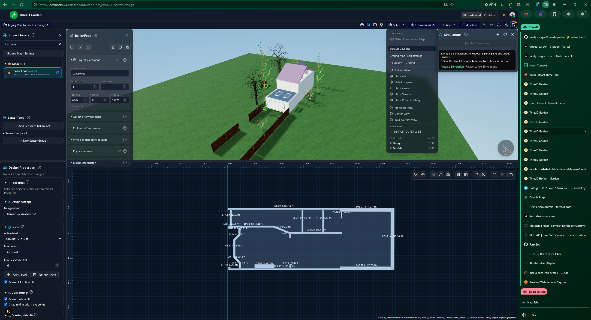

# ThreeD Garden

ThreeD Garden combines interactive 3D scenes, geographic maps, architectural drawing, animated Characters and multimedia in a Project workspace. Organize reusable assets in Admin, compose a Project in Dashboard, then explore it in 3D, Design, 2D or Combined view.



Existing Developer-approved local screenshot from October 14, 2026; it illustrates the workspace, not current production verification.

[Demo](https://threedgarden.com/#garden-demo) · [Learn](https://threedgarden.com/learn) · [Getting started](docs/users/GETTING_STARTED.md) · [Documentation](docs/README.md)

Developer-confirmed production release: **[v0.26.16 - ThreeD Multimedia: Ownership and Blueprint pages](docs/releases/v0.26.16.md)**. See [current context](CONTEXT.md) for evidence boundaries and local work.

## Main capabilities

- Compose Project Models, Beds, Plantings, Characters and FarmBots in linked maps and 3D scenes, with Layers and explicit Project Save.
- Draw and edit walls, floors, doors/windows, named levels and roofs with cutouts/skylights. Use linked 2D/3D Design views, measurements, Undo/Redo and validated JSON import/export.
- Import FBX, GLB, GLTF and OBJ/MTL assets; inspect Model Files, assign Textures and Categories, preview assets and generate supported Models with the Builder.
- Animate Characters, take control with WASD and run supported Simulations with captured Results. Scenario plans and Simulation execution remain distinct.
- Use Albums, Tracks, Media and Speech alongside Projects. FarmBot integration exposes scoped status and assembly drafts; physical commands remain disabled.

## Local setup

Use Node.js **24** (see [.nvmrc](.nvmrc)) and **npm 11.6.2** (packageManager in [package.json](package.json)). Follow [Local development](docs/developers/LOCAL_DEVELOPMENT.md) for environment and database setup before running the App.

```bash
npm install --global npm@11.6.2
npm ci
npm run dev
```

Open [localhost:4444](http://localhost:4444); the Scene route is `/dashboard/scene`. Coding agents must leave Developer servers and their active installation untouched; see [AGENTS.md](AGENTS.md).

## Validation

```bash
npm run typecheck
npm run validate -- ci
npm run build
```

GitHub validation uses a clean `npm ci` and checks lockfile integrity. Build and validation instructions, including isolated offline agent checks, are in the [validation guide](docs/agents/VALIDATION.md). Database schema commands are described separately in [Local development](docs/developers/LOCAL_DEVELOPMENT.md#database-schema-commands).

## Contribute and explore

[Architecture](docs/developers/ARCHITECTURE.md) · [Data model](docs/developers/DATA_MODEL.md) · [Contribution workflow](docs/agents/TASK_CHECKLISTS.md) · [Agent guidance](docs/agents/README.md) · [Deployment](docs/developers/DEPLOYMENT.md) · [MIT License](LICENSE) · [Release history](docs/releases/README.md)

The [legacy-v0.17 branch](https://github.com/marty-mcgee/threed-garden/tree/legacy-v0.17) and [migration record](docs/plans/threed-garden-repository-migration.md) preserve the original repository provenance.
