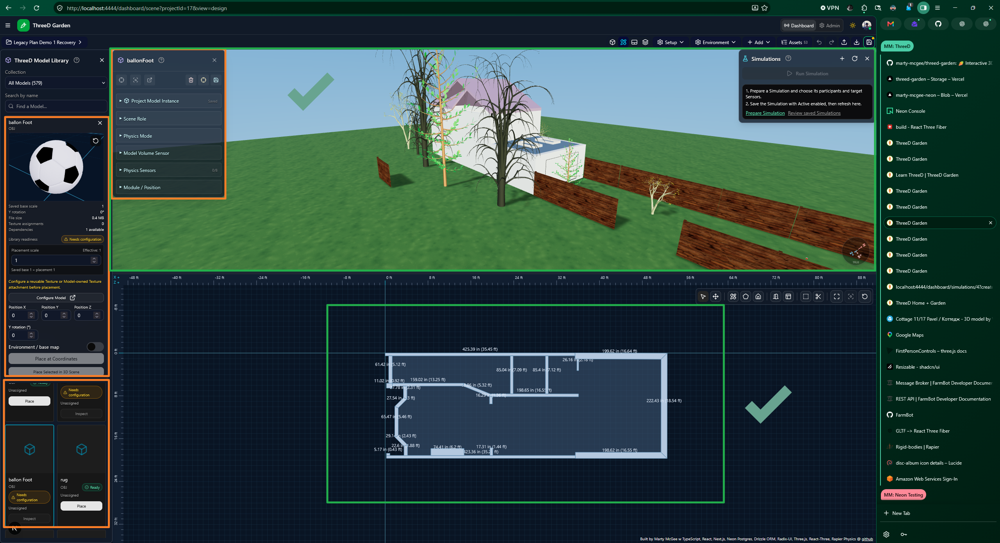

# 🥕 ThreeD Garden

### Plan your space. Build your world. Bring it to life.

**ThreeD App** brings architectural drawing, interactive 3D scenes, geographic maps, animated Characters, garden planning, and Multimedia into one Project workspace. Build a reusable asset library, compose your Scene, and explore it through linked views.

[](https://github.com/marty-mcgee/threed-garden/actions/workflows/validation.yml)


**[🌐 Visit ThreeD Garden](https://threedgarden.com/)** · **[🎮 Explore the demo](https://threedgarden.com/#garden-demo)** · **[📚 Learn ThreeD](https://threedgarden.com/learn)** · **[🚀 Get started](docs/users/GETTING_STARTED.md)**


*Architectural content and reusable Models share a Project workspace. This repository screenshot documents an earlier interface checkpoint; current controls may differ.*

## ✨ What can you create?

| Your goal | Start with |
| --- | --- |
| 🏡 Sketch a building and inspect it in 3D | **Design** — walls, floors, openings, levels, and roofs |
| 🌱 Arrange a garden or farm scene | **Projects** — Beds, Plantings, Models, and geographic context |
| 🧩 Organize and reuse 3D assets | **Models** — Files, Textures, Categories, and previews |
| 🚶 Explore an animated world | **Characters** — animation mappings, movement, and supported Actions |
| ⚽ Run an interactive example | **Simulations** — supported Actions, Sensors, and captured Results |
| 🎵 Browse and play content | **Multimedia** — Albums, Tracks, Media, Links, and Speech |

## 🧭 Explore the modules

- [🌍 Projects, Scenes, and Maps](#-projects-scenes-and-maps)
- [📐 Design and Architecture](#-design-and-architecture)
- [🧩 Models, Files, and Textures](#-models-files-and-textures)
- [🏗 Model Builder](#-model-builder)
- [🚶 Characters, Animations, and Actions](#-characters-animations-and-actions)
- [⚽ Physics, Sensors, Scenarios, and Simulations](#-physics-sensors-scenarios-and-simulations)
- [🌱 Garden Planning and FarmBot](#-garden-planning-and-farmbot)
- [🎵 Multimedia](#-multimedia)
- [🚦 Traffic and Geographic Information](#-traffic-and-geographic-information)
- [⚙ Administration and Workspace Settings](#-administration-and-workspace-settings)
- [💻 Run locally](#-run-locally)

## 🌍 Projects, Scenes, and Maps

A **Project** brings enabled modules and assigned assets into a shared workspace. Use Dashboard to compose and explore; use Admin to manage reusable records and configuration.

- Switch between **3D, Design, 2D, and Combined** views of the active Project.
- Place and inspect Models, Characters, Beds, Plantings, and FarmBots.
- Use Project Assets and Layers to find content and manage visibility.
- Open a Model's **DetailsCard** for supported placement, appearance, movement, and inspection controls.
- Save supported Project content and workspace state through the existing Project Save/load workflow.
- Work with geographic maps and Ground Map settings alongside the Scene.

**Learn more:** [Dashboard guide](docs/users/DASHBOARD_GUIDE.md) · [Ground Maps](docs/users/THREED_GROUND_MAPS.md) · [Scene controls](docs/users/THREED_CONTROLS.md)

## 📐 Design and Architecture

Draw a flat plan and see its corresponding architecture in the Project's 3D Scene. Design content remains editable after saving; it is more than a flattened model export.

- **Walls and floors:** draw, select, reposition, and edit dimensions.
- **Doors and windows:** place hosted openings and adjust supported dimensions and sill settings.
- **Named levels:** organize architecture by elevation and control supported level visibility.
- **Roofs:** create supported flat, shed, and gable forms, with cutouts and skylights.
- **Drawing controls:** snapping, pan/zoom, rulers, measurements, and Undo/Redo.
- **Appearance:** supported Design transparency and calibrated Model top-view images.
- **Portable plans:** validated JSON import/export, with supported merge or architecture-only replacement.
- **Project integration:** architectural entries in Project Assets, linked selection, and shared Project Save/load.

Project measurement preferences support Imperial and Metric presentation. Advanced roof joins, stairs, annotations, and other extensions have separate implementation scopes; this is not a claim that every CAD feature is available.

**Learn more:** [ThreeD Designs](docs/developers/THREED_DESIGNS.md) · [Architecture capabilities and planned extensions](docs/plans/design-architecture-capabilities.md)

## 🧩 Models, Files, and Textures

Keep reusable **Models** separate from the instances placed in your Projects.

- Import supported **FBX, GLB, GLTF, and OBJ/MTL** assets.
- Manage primary geometry and supporting **Model Files**.
- Review dependency/readiness information and inspect individual assets in previews.
- Organize Models with hierarchical **Categories** and supported bulk operations.
- Assign reusable **Textures**, including supported base-color, normal, roughness, metallic, occlusion, and emissive channels.
- Use preview Fit/Reset and supported transparent PNG captures.
- Add owned Model top-view PNGs for calibrated representation in the Design plan.
- Inspect a reusable asset in the Library, then place an instance into a Project.

Asset compatibility depends on the source geometry, rig, materials, and available dependencies; readiness information does not guarantee every third-party file will render correctly.

**Learn more:** [Model administration](docs/developers/THREED_MODEL_ADMIN.md) · [Model runtime API](docs/developers/THREED_MODEL_RUNTIME_API.md) · [OBJ/MTL import](docs/developers/THREED_LEGACY_OBJ_IMPORT.md)

## 🏗 Model Builder

Generate the supported parametric Cottage using editable dimensions and a repeatable generation recipe.

- Adjust dimensions and generate a preview.
- Produce Cottage geometry with procedural PBR textures and transparent glazing.
- Download supported GLB and generation-manifest outputs or capture a preview image.
- Use **Save as New Model** for guarded registration with managed assets and Textures.
- Review and activate the resulting Model before placing it through a Project Library.

Generation does not automatically replace another Model or place it in a Project. The Builder guide records supported export paths and remaining acceptance work.

**Learn more:** [Model Builder guide](docs/developers/THREED_MODEL_BUILDER.md)

## 🚶 Characters, Animations, and Actions

Bring Scenes to life with supported rigged Models, assigned animations, and interactive controls.

- Preview Character assets and configure animation mappings.
- Use supported idle, walk, run, turning, and task animations where compatible clips exist.
- Take or release control through DetailsCard; supported controlled Characters use **WASD** movement.
- Let configured Characters move autonomously.
- Trigger supported Actions such as Water and Pick Fruit when their prerequisites are met.
- Inspect placement, physics, Sensors, and available Actions through the existing interface.

Animation previews and world-changing Actions have different responsibilities. Available behavior depends on the Character, mappings, targets, and runtime support.

**Learn more:** [Character guide](docs/developers/THREED_CHARACTERS.md) · [Animation library](docs/developers/THREED_ANIMATIONS_LIBRARY.md) · [User controls](docs/users/THREED_CONTROLS.md)

## ⚽ Physics, Sensors, Scenarios, and Simulations

Combine supported physical interactions with explicit plans, execution, and observation.

| Feature set | Role |
| --- | --- |
| **Physics** | Runtime collisions and supported movement/interactions |
| **Sensors** | Configured observations, contacts, and counters |
| **Scenarios** | Plans and guidance — **Open Scenario** |
| **Simulations** | Execute supported Actions — **Run Simulation** |
| **Results** | Captured execution and Sensor observations for review |

Playable soccer exercises Character movement, targeted kicks, ball interaction, and goal-related measurements. Simulation definitions are managed in Admin; supported execution takes place in the Project Scene. Captured Results remain separate from editable definitions.

This is a supported Action system, not an arbitrary automation engine. Broader executors and physical device control are outside the documented current scope.

**Learn more:** [Simulation guide](docs/developers/THREED_SIMULATIONS.md) · [Physics and Sensors](docs/developers/THREED_PHYSICS_SENSORS.md)

## 🌱 Garden Planning and FarmBot

Build a garden context using Plants, Beds, Plantings, and related records, then bring assigned assets into a Project.

- Manage garden records, tasks, watering information, and harvest records through supported Admin workflows.
- Arrange supported Beds and Plantings in the Project workspace.
- Reuse FarmBot component Models and compose local Assembly drafts with relative transforms and JSON import/export.
- Configure owner-scoped FarmBot connections and inspect read-only status, timestamps, and device position.
- Present relevant FarmBot observations in the Scene, DetailsCard, and Scenario guidance.

**Physical FarmBot commands remain disabled.** Read-only connectivity and simulated Actions do not authorize movement, watering, or other hardware commands.

**Learn more:** [Admin guide](docs/users/ADMIN_GUIDE.md) · [FarmBot integration](docs/developers/FARMBOT_INTEGRATION.md) · [Read-only MQTT worker](docs/developers/FARMBOT_MQTT_WORKER.md)

## 🎵 Multimedia

Browse a content library and use the shared Dashboard Player for supported audio and video.

- **Albums:** organize collections, artwork, and related content.
- **Tracks:** browse ordered content and open direct Album/Track URLs.
- **Media:** view supported audio/video attachments with responsive cards and retry feedback.
- **Links:** associate related destinations with content.
- **Speech:** manage supported Speech content and publishing workflows.
- **Playback:** shared Player, artwork, supported waveform presentation, and browser-history navigation without automatic playback on restoration.

Admin provides content management; Dashboard provides discovery and playback. File visibility and delivery follow existing authorization. Playback depends on browser codec support and media availability.

**Learn more:** [Dashboard Multimedia](docs/users/DASHBOARD_GUIDE.md) · [Latest Multimedia checkpoint](docs/releases/v0.26.17.md)

## 🚦 Traffic and Geographic Information

Explore the combined Traffic map/list interface and focused provider pages.

- Supported source views include **CHP, Caltrans, CalFire, and Bay Area 511**.
- Toggle sources and inspect returned records on maps and lists.
- Select a list item to focus its marker, or a marker to reveal its corresponding item.
- Review source-specific loading and availability feedback.

Coverage and freshness depend on the upstream providers and configured integrations.

**Learn more:** [Dashboard guide](docs/users/DASHBOARD_GUIDE.md)

## ⚙ Administration and Workspace Settings

Manage reusable content in **Admin**, then work with assigned content in **Dashboard**.

- Configure Projects and enabled modules.
- Assign active assets to Projects; activation alone does not assign an asset.
- Manage module records through their established forms and related lists.
- Use supported Save/Discard feedback and validation.
- Adjust personal appearance and navigation preferences through workspace Settings.

**Learn more:** [Admin guide](docs/users/ADMIN_GUIDE.md) · [Personal settings](docs/users/SETTINGS.md)

## 📸 Another look



*An earlier annotated workspace review showing the interface refinement process. Screenshots show the interfaces at their capture dates.*

## 📚 Learn and explore

| For… | Start here |
| --- | --- |
| New visitors | [Learn ThreeD](https://threedgarden.com/learn) · [Getting started](docs/users/GETTING_STARTED.md) |
| Project creators | [Dashboard](docs/users/DASHBOARD_GUIDE.md) · [Controls](docs/users/THREED_CONTROLS.md) |
| Content managers | [Admin](docs/users/ADMIN_GUIDE.md) · [Models](docs/developers/THREED_MODEL_ADMIN.md) |
| Developers | [Architecture](docs/developers/ARCHITECTURE.md) · [Data model](docs/developers/DATA_MODEL.md) · [API](docs/developers/API_GUIDE.md) |
| Contributors and coding agents | [Working instructions](AGENTS.md) · [Task checklists](docs/agents/TASK_CHECKLISTS.md) |

## 🛠 Technology

| Layer | Tools |
| --- | --- |
| 🟦 Application | Next.js · React · TypeScript |
| 🟪 3D rendering | Three.js · React Three Fiber · Drei |
| 🟧 Movement and physics | Rapier · Ecctrl |
| 🟩 Maps and persistence | Leaflet · Neon Postgres · Drizzle ORM |
| 🎨 Interface | Tailwind CSS · shadcn/ui · Radix UI |
| 🔐 Authentication | Auth.js / NextAuth |
| ☁ Asset integrations | Vercel Blob · AWS S3 |
| 🤖 Device status | MQTT and FarmBot integration |

## 💻 Run locally

Use **Node.js 24** and **npm 11.6.2**, matching [.nvmrc](.nvmrc) and [package.json](package.json). Follow [Local development](docs/developers/LOCAL_DEVELOPMENT.md) to configure the required environment and database first.

```bash
npm install --global npm@11.6.2
npm ci
npm run dev
```

Open [localhost:4444](http://localhost:4444). The main Scene route is `/dashboard/scene`. Coding agents must leave Developer servers and their active installation untouched; see [AGENTS.md](AGENTS.md).

### Checks and production build

```bash
npm run typecheck
npm run validate -- ci
npm run build
```

See the [validation guide](docs/agents/VALIDATION.md) for task-specific and isolated checks, and the [deployment guide](docs/developers/DEPLOYMENT.md) for production setup. Database generation and live schema operations are documented separately in the [database workflow](docs/developers/LOCAL_DEVELOPMENT.md#database-schema-commands).

## 🗺 Status and contribution

Developer-confirmed production release: **[v0.26.17 - ThreeD Multimedia: Player layout and direct links](docs/releases/v0.26.17.md)**. See [release history](docs/releases/README.md) for checkpoint details and [current context](CONTEXT.md) for current scope, acceptance, and known limitations.

Have a reproducible bug or a focused feature idea? [Open an issue](https://github.com/marty-mcgee/threed-garden/issues). Before contributing, review the [contribution workflow](docs/agents/TASK_CHECKLISTS.md), existing ownership boundaries, and applicable checks.

The [legacy-v0.17 branch](https://github.com/marty-mcgee/threed-garden/tree/legacy-v0.17) and [repository migration record](docs/plans/threed-garden-repository-migration.md) preserve the original project history.

## ⚖ License

Application code is licensed under the [MIT License](LICENSE). Third-party Models, textures, audio, video, and other assets may carry separate licenses; check their individual terms before reuse.
