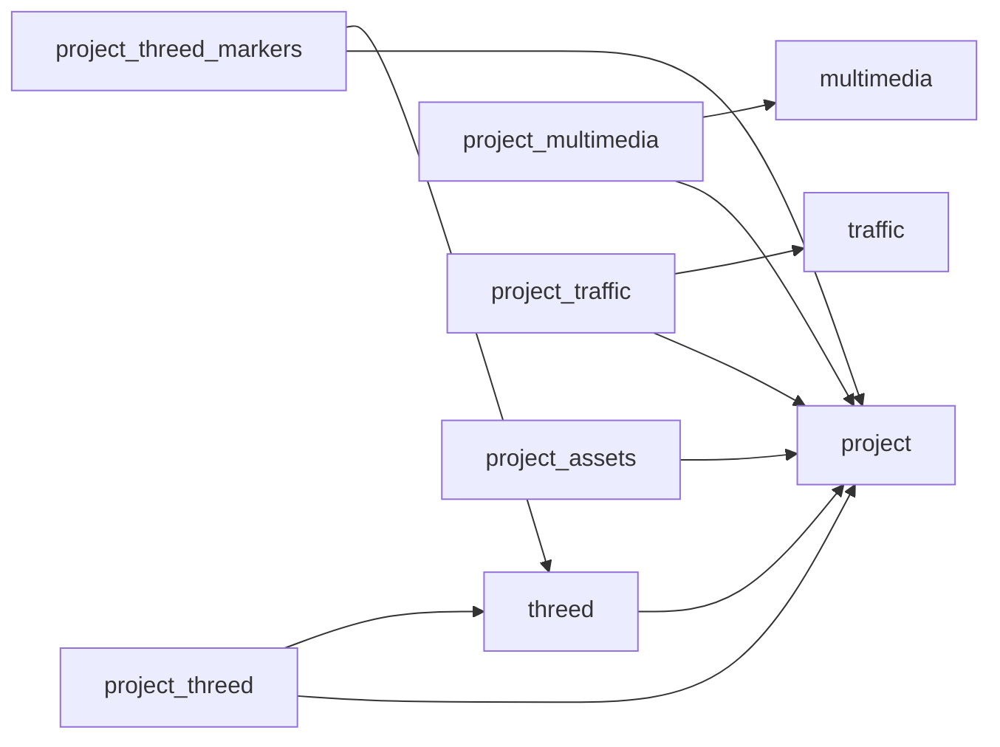

# ThreeD App data structure

[Open the interactive schema explorer](app-data-structure.html) · [Structured schema snapshot](app-data-structure.json) · [Established App architecture](../plans/app-module-architecture.md)

Snapshot: 2026-10-29, App 0.29.2-alpha, main / 02c2447b plus working-tree changes. Generated from the actual local Drizzle declarations, without a database connection. This visualizes the existing structure; it does not introduce a new architecture.

## Explore the structure

Open the HTML file directly in a browser; it needs no server, network or CDN. Select a Top Module or shared foundation, search a table or column, and choose a table to inspect its fields, constraints and incoming/outgoing relationships. Solid arrows indicate declared foreign keys. Application mappings and ORM declarations are separate optional layers. The Assembly identity migration is explicitly marked as pending.

## Coverage

| Domain | Tables | Columns | Foreign keys |
| --- | ---: | ---: | ---: |
| ThreeD | 46 | 669 | 105 |
| Multimedia | 13 | 136 | 24 |
| Traffic | 10 | 227 | 10 |
| Learn | 1 | 13 | 2 |
| Projects (shared) | 6 | 84 | 15 |
| Accounts (shared) | 5 | 48 | 2 |
| Settings (shared) | 5 | 53 | 6 |
| **Total** | **86** | **1230** | **164** |

Also includes **37 enums**, **161 ORM relation declarations** and **53 reviewed application mappings**. Counts describe source declarations, not verified live database objects. Auth aliases are deduplicated. Composite foreign keys remain single relationships with all participating columns. JSON/JSONB columns are shown without inventing their nested structures.

## Project and Module relationships

The following overview shows actual foreign keys. A Project can have multiple junction rows; each row identifies one Project and one Module instance. Content assignments are separately stored in project_assets. Learn is a peer Top Module with current content in learn_guides; no nonexistent Learn root or Project junction is drawn.



The interactive explorer expands polymorphic asset/Module links using the actual application registries. It does not infer extra links from names or enum entries. The source threed_multimedia_albums entity ID is now text, with kind-specific numeric/UUID checks. Its identity migration is prepared for manual review and is not confirmed applied. Learn-to-Guide Album associations are absent from the current registry; the old Learn SQL remains on hold.

## Complete table inventory

### ThreeD

| Table | Columns | Outgoing FKs |
| --- | ---: | ---: |
| [`threed`](../../src/libraries/schema/threed/index.ts) | 13 | 2 |
| [`threed_animation_action_slots`](../../src/libraries/schema/threed/index.ts) | 9 | 2 |
| [`threed_animation_categories`](../../src/libraries/schema/threed/index.ts) | 5 | 1 |
| [`threed_animation_category_assignments`](../../src/libraries/schema/threed/index.ts) | 4 | 3 |
| [`threed_animation_files`](../../src/libraries/schema/threed/index.ts) | 10 | 1 |
| [`threed_animation_preset_entries`](../../src/libraries/schema/threed/index.ts) | 8 | 3 |
| [`threed_animation_presets`](../../src/libraries/schema/threed/index.ts) | 7 | 1 |
| [`threed_animations`](../../src/libraries/schema/threed/index.ts) | 11 | 2 |
| [`threed_assembly`](../../src/libraries/schema/threed/index.ts) | 6 | 1 |
| [`threed_assembly_components`](../../src/libraries/schema/threed/index.ts) | 13 | 2 |
| [`threed_assembly_model_assignments`](../../src/libraries/schema/threed/index.ts) | 3 | 2 |
| [`threed_assembly_revisions`](../../src/libraries/schema/threed/index.ts) | 5 | 1 |
| [`threed_beds`](../../src/libraries/schema/threed/index.ts) | 23 | 1 |
| [`threed_character_animation_assignments`](../../src/libraries/schema/threed/index.ts) | 8 | 3 |
| [`threed_character_models`](../../src/libraries/schema/threed/index.ts) | 8 | 3 |
| [`threed_characters`](../../src/libraries/schema/threed/index.ts) | 42 | 2 |
| [`threed_designs`](../../src/libraries/schema/threed/index.ts) | 10 | 2 |
| [`threed_farmbot_broker_metadata`](../../src/libraries/schema/threed/index.ts) | 13 | 2 |
| [`threed_farmbot_commands`](../../src/libraries/schema/threed/index.ts) | 32 | 4 |
| [`threed_farmbot_emergency_actions`](../../src/libraries/schema/threed/index.ts) | 22 | 3 |
| [`threed_farmbot_logs`](../../src/libraries/schema/threed/index.ts) | 11 | 2 |
| [`threed_farmbot_peripheral_bindings`](../../src/libraries/schema/threed/index.ts) | 11 | 2 |
| [`threed_farmbots`](../../src/libraries/schema/threed/index.ts) | 26 | 2 |
| [`threed_ground_maps`](../../src/libraries/schema/threed/index.ts) | 14 | 2 |
| [`threed_harvests`](../../src/libraries/schema/threed/index.ts) | 14 | 3 |
| [`threed_layers`](../../src/libraries/schema/threed/index.ts) | 16 | 1 |
| [`threed_model_animation_assignments`](../../src/libraries/schema/threed/index.ts) | 8 | 3 |
| [`threed_model_categories`](../../src/libraries/schema/threed/index.ts) | 10 | 2 |
| [`threed_model_category_assignments`](../../src/libraries/schema/threed/index.ts) | 6 | 3 |
| [`threed_model_files`](../../src/libraries/schema/threed/index.ts) | 14 | 2 |
| [`threed_model_material_assignments`](../../src/libraries/schema/threed/index.ts) | 8 | 3 |
| [`threed_model_textures`](../../src/libraries/schema/threed/index.ts) | 13 | 1 |
| [`threed_models`](../../src/libraries/schema/threed/index.ts) | 30 | 2 |
| [`threed_mqtt_events`](../../src/libraries/schema/threed/index.ts) | 21 | 1 |
| [`threed_mqtt_runtime`](../../src/libraries/schema/threed/index.ts) | 20 | 1 |
| [`threed_multimedia_albums`](../../src/libraries/schema/threed/album-associations.ts) | 7 | 1 |
| [`threed_plantings`](../../src/libraries/schema/threed/index.ts) | 24 | 4 |
| [`threed_plants`](../../src/libraries/schema/threed/index.ts) | 36 | 2 |
| [`threed_scenarios`](../../src/libraries/schema/threed/index.ts) | 11 | 3 |
| [`threed_simulation_results`](../../src/libraries/schema/threed/index.ts) | 14 | 4 |
| [`threed_simulations`](../../src/libraries/schema/threed/index.ts) | 12 | 3 |
| [`threed_system_logs`](../../src/libraries/schema/threed/index.ts) | 9 | 1 |
| [`threed_tasks`](../../src/libraries/schema/threed/index.ts) | 19 | 5 |
| [`threed_watering_history`](../../src/libraries/schema/threed/index.ts) | 20 | 5 |
| [`threed_watering_schedules`](../../src/libraries/schema/threed/index.ts) | 27 | 5 |
| [`threed_weather_logs`](../../src/libraries/schema/threed/index.ts) | 16 | 1 |

### Multimedia

| Table | Columns | Outgoing FKs |
| --- | ---: | ---: |
| [`multimedia`](../../src/libraries/schema/multimedia/index.ts) | 12 | 1 |
| [`multimedia_albums`](../../src/libraries/schema/multimedia/index.ts) | 13 | 1 |
| [`multimedia_links`](../../src/libraries/schema/multimedia/index.ts) | 14 | 3 |
| [`multimedia_lyrics`](../../src/libraries/schema/multimedia/index.ts) | 9 | 1 |
| [`multimedia_lyrics_albums`](../../src/libraries/schema/multimedia/index.ts) | 3 | 2 |
| [`multimedia_lyrics_projects`](../../src/libraries/schema/multimedia/index.ts) | 3 | 2 |
| [`multimedia_lyrics_tracks`](../../src/libraries/schema/multimedia/index.ts) | 3 | 2 |
| [`multimedia_media`](../../src/libraries/schema/multimedia/index.ts) | 14 | 2 |
| [`multimedia_playback_history`](../../src/libraries/schema/multimedia/index.ts) | 8 | 3 |
| [`multimedia_polling_logs`](../../src/libraries/schema/multimedia/index.ts) | 9 | 1 |
| [`multimedia_speech`](../../src/libraries/schema/multimedia/index.ts) | 13 | 2 |
| [`multimedia_speech_versions`](../../src/libraries/schema/multimedia/index.ts) | 20 | 2 |
| [`multimedia_tracks`](../../src/libraries/schema/multimedia/index.ts) | 15 | 2 |

### Traffic

| Table | Columns | Outgoing FKs |
| --- | ---: | ---: |
| [`traffic`](../../src/libraries/schema/traffic/index.ts) | 12 | 1 |
| [`traffic_api_request_logs`](../../src/libraries/schema/traffic/index.ts) | 14 | 1 |
| [`traffic_bay_area_511_events`](../../src/libraries/schema/traffic/index.ts) | 24 | 1 |
| [`traffic_calfire_incidents`](../../src/libraries/schema/traffic/index.ts) | 29 | 1 |
| [`traffic_caltrans_cctv_cameras`](../../src/libraries/schema/traffic/index.ts) | 24 | 1 |
| [`traffic_caltrans_districts`](../../src/libraries/schema/traffic/index.ts) | 16 | 1 |
| [`traffic_caltrans_lane_closures`](../../src/libraries/schema/traffic/index.ts) | 28 | 1 |
| [`traffic_chp_cad_incidents`](../../src/libraries/schema/traffic/index.ts) | 30 | 1 |
| [`traffic_chp_cases`](../../src/libraries/schema/traffic/index.ts) | 30 | 1 |
| [`traffic_chp_centers`](../../src/libraries/schema/traffic/index.ts) | 20 | 1 |

### Learn

| Table | Columns | Outgoing FKs |
| --- | ---: | ---: |
| [`learn_guides`](../../src/libraries/schema/learn/index.ts) | 13 | 2 |

### Projects

| Table | Columns | Outgoing FKs |
| --- | ---: | ---: |
| [`project`](../../src/libraries/schema/project/index.ts) | 24 | 1 |
| [`project_assets`](../../src/libraries/schema/project/index.ts) | 11 | 2 |
| [`project_multimedia`](../../src/libraries/schema/project/index.ts) | 8 | 3 |
| [`project_threed`](../../src/libraries/schema/project/index.ts) | 8 | 3 |
| [`project_threed_markers`](../../src/libraries/schema/project/index.ts) | 25 | 3 |
| [`project_traffic`](../../src/libraries/schema/project/index.ts) | 8 | 3 |

### Accounts

| Table | Columns | Outgoing FKs |
| --- | ---: | ---: |
| [`user`](../../src/libraries/schema/auth/index.ts) | 16 | 0 |
| [`user_accounts`](../../src/libraries/schema/auth/index.ts) | 15 | 1 |
| [`user_role_audit`](../../src/libraries/schema/auth/user-role-audit.ts) | 6 | 0 |
| [`user_sessions`](../../src/libraries/schema/auth/index.ts) | 6 | 1 |
| [`user_verifications`](../../src/libraries/schema/auth/index.ts) | 5 | 0 |

### Settings

| Table | Columns | Outgoing FKs |
| --- | ---: | ---: |
| [`settings`](../../src/libraries/schema/settings/index.ts) | 16 | 0 |
| [`settings_audit_logs`](../../src/libraries/schema/settings/index.ts) | 9 | 2 |
| [`settings_deployment`](../../src/libraries/schema/settings/index.ts) | 12 | 1 |
| [`settings_deployment_history`](../../src/libraries/schema/settings/index.ts) | 9 | 1 |
| [`settings_user_overrides`](../../src/libraries/schema/settings/index.ts) | 7 | 2 |

## Refresh and verification

Run from the workspace root using the declared Node installation:

```powershell
node src/libraries/scripts/generate-schema-visualization.cjs
node src/libraries/scripts/generate-schema-visualization.cjs --check
```

The generator loads only schema files and Drizzle through a dependency allowlist; it does not load environment files, a database client or service modules. It checks complete table/enum export coverage, deduplicated identities and every relationship endpoint. --check verifies generated files against the current source without writing them. SQL application, browser acceptance and production evidence remain separate in the [release record](../releases/v0.30.0.md).
