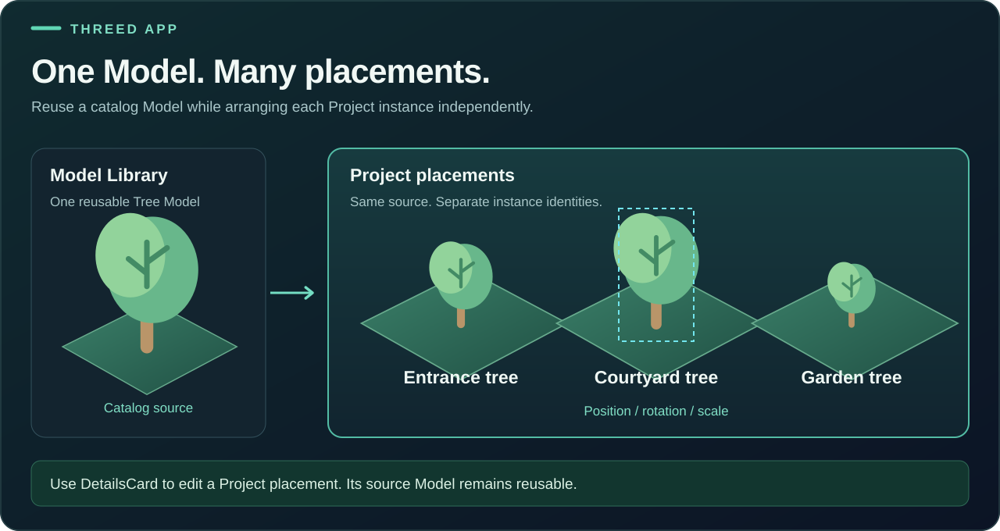
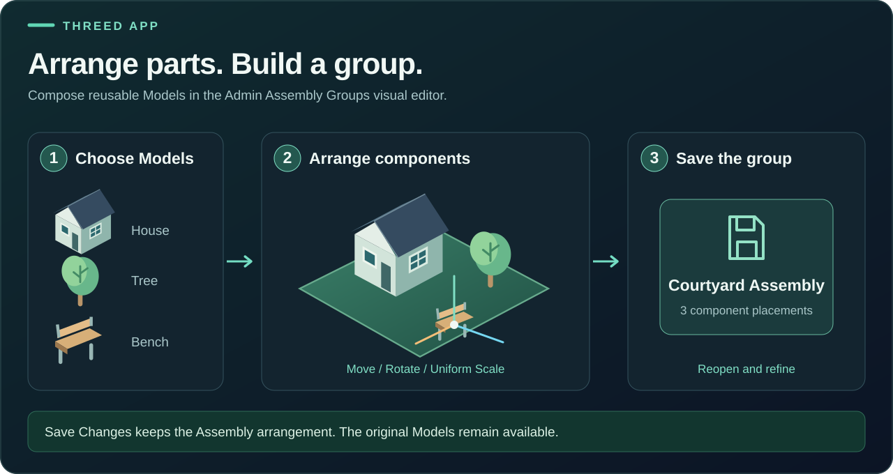
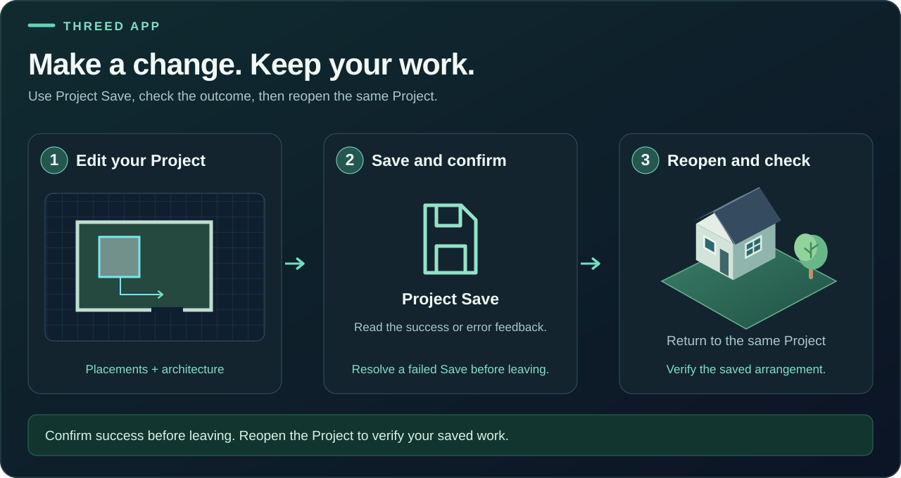
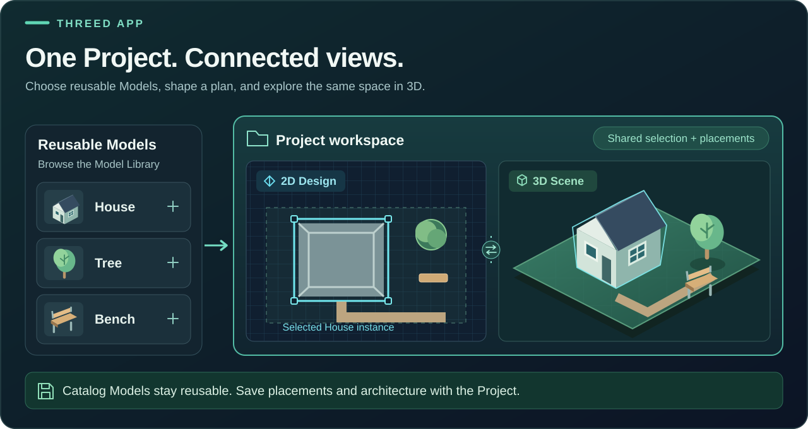

# ThreeD App illustrations

Supporting illustrations in the same visual style as [Project workflow](project-workflow.svg): editable SVGs, navy and teal panels, spatial drawings and short labels. These explain concepts alongside actual App screen captures; they are not interface screenshots. Open an image for its full-size view.

## One Model. Many placements.

One catalog Model can supply several Project placements. Each instance has its own identity and transform; edit the selected placement through **ThreeD > Project > Model > DetailsCard**. Moving an instance does not modify its catalog source.

## Arrange parts. Build a group.

Choose Models in the Admin Assembly Groups editor, arrange components with Move, Rotate and uniform Scale, then use **Save Changes**. Reopen the group to refine it. This describes composition, not automatic placement in a Project Scene.

## Make a change. Keep your work.

Make your changes, use Project Save and read its result. Resolve a failed Save before leaving. Reopen the same Project to check the saved arrangement.

## One Project. Connected views.

The original illustration introduces the relationship between reusable Models, Project placements and connected views.

All four SVGs include descriptive titles and text alternatives, with no external image or font dependencies. Use them as supporting material with the [Learn image requirement](../../developers/LEARN_ART_IMAGE_REQUIREMENT.md). The [main README](../../../README.md) retains actual App captures.
