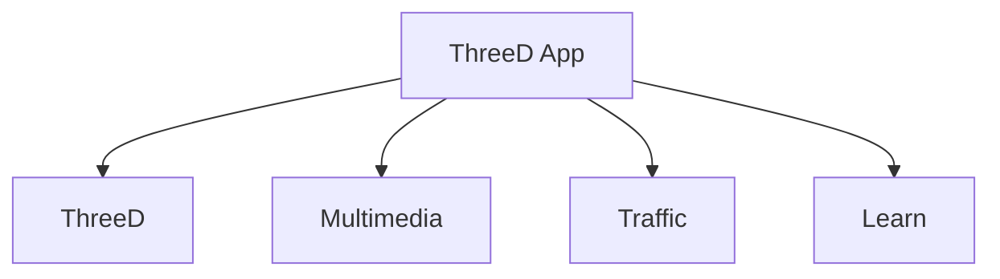

# ThreeD App: Schema-First, Top-Down Module Plan

This plan documents the App's **existing Schema-First, Top-Down architecture**, reaffirmed by the Developer on October 28, 2026. The architecture has always governed this App; it is not a new structure to create. This record corrects the agent's understanding and supersedes conflicting planning assumptions. Work must follow the existing schemas, identities, ownership and relationship conventions. Earlier implementation and validation evidence remains in the [v0.30.0 release record](../releases/v0.30.0.md).

The requested [data structure visualization](../developers/APP_DATA_STRUCTURE.md) provides an interactive view of the existing tables, fields and relationships. It is a reference for understanding the App, not a redesign prerequisite.

The [October 29 v0.30.0 integration reassessment](../releases/v0.30.0.md#october-29--integration-reassessment-and-next-steps) applies this structure to the existing Album implementation and the Radio/TRADE Scene milestone. Feature scope, concrete corrections, delivery order and verification remain in that release record.

## Established structure

ThreeD App has exactly four **Top Modules**, as peers:

Each Top Module owns its sub-modules and records. Top Modules connect through **many-to-many relationships**. The schema defines those relationships, their identities and ownership before services, APIs, editors or runtime interactions are implemented.

The implementation order is:

**Module hierarchy → schema identities and relationships → ownership and validation → services/API → Admin controls → front-end and Scene behavior.**

Dashboard and Admin are application surfaces. Navigation placement, appearance keys, routes and record names do not define relationship ownership. The four-Module hierarchy does not by itself choose a universal junction table, authorize every possible Module pair, or require identical persistence and permissions for all four Modules.

## Identity and relationship contract

| Level | Meaning |
| --- | --- |
| Top Module | One of ThreeD, Multimedia, Traffic or Learn; owns its domain and sub-module types. |
| Saved Module instance | A persisted configuration or collection within a Top Module, where the schema defines one. Its ID is distinct from a content-record ID. |
| Sub-module | A type within its owning Top Module, such as Models within ThreeD or Albums within Multimedia. |
| Record | A particular Model, Album or other typed entity, identified by its actual primary key. |
| Project assignment | Explicit membership of a Module instance or asset in a Project, with its own scope and authority. |
| Scene instance | A particular placed object within a Project, retaining its runtime marker identity and reference to its source record. |

Read each relationship through its owning Top Modules, endpoint identities, cardinality, Project scope, permissions, uniqueness and deletion behavior in the existing schema and callers. Concrete record associations express uses of the Module integration. Project membership and reusable catalog associations remain distinct. These distinctions do not imply a new root-to-root junction or replacement relationship system.

The Developer's example is **ThreeD → Model "Design: Radio" ↔ Multimedia → Album "TRADE"**, with the Album also assigned to **ThreeD Garden Demo Project**. Selecting the placed Radio should expose Album information and Tracks through its interaction UI. "Design:" is part of the Model's name; it does not turn that record into an architectural Design. This feature must use the App's established relationship architecture.

## Existing schema references

The local schema audit found the following structure:

| Top Module | Current Module table | Current Project junction |
| --- | --- | --- |
| ThreeD | [threed](../../src/libraries/schema/threed/index.ts) | `project_threed` |
| Multimedia | [multimedia](../../src/libraries/schema/multimedia/index.ts) | `project_multimedia` |
| Traffic | [traffic](../../src/libraries/schema/traffic/index.ts) | `project_traffic` |
| Learn | [learn_guides](../../src/libraries/schema/learn/index.ts) is the current content table; no comparable saved Module-instance table is declared | None declared |

The [Project schema](../../src/libraries/schema/project/index.ts) already has Project-to-Module many-to-many junctions. Its `project_assets` table distinguishes `module_type` / `module_id` from `asset_type` / `asset_id`. Models and Albums are reusable catalogs; neither currently has a direct foreign key to its respective root Module table. Scenarios and Simulations have explicit Project/ThreeD references. Follow these existing distinctions rather than replacing them with an assumed uniform hierarchy of foreign keys.

The current [Project asset registry](../../src/libraries/project-assets/asset-registry.ts), workspace settings and Project templates enumerate only ThreeD, Multimedia and Traffic. These are observations about those particular capabilities. They neither change Learn's Top Module identity nor independently establish a need for new tables or Project support.

The applied `threed_multimedia_albums` table represents **ThreeD record ↔ Album** relationships. Its `module_type` column currently means a sub-module discriminator such as `model` or `plant`; it does not mean the Top Module identity used by `project_assets.module_type`. This describes the table's actual role, not a requirement to add a separate root ThreeD/Multimedia instance pair. Preserve the applied table and existing data while reviewing recent changes against the established App architecture.

The unaccepted `learn → learn_guides` Album mapping and guide-editor controls have been excluded from the current application path. Learn remains a peer Top Module with its existing shared guide CRUD. The retained follow-up SQL is on hold and must not be executed. Neither a Guide-to-Album relationship nor a new Learn root table is a prerequisite for the ThreeD/Multimedia integration.

The [appearance registry](../../src/libraries/config/module-appearance.ts) legitimately includes surfaces, Top Modules and sub-modules for styling. Its keys must not become schema authority. Relationship controls must use the owning domain and record identity established by the schema and existing application contract; inferring them from route appearance has already produced a Designs/Project ownership mismatch.

## Review of recent work

- Trace the existing relationship endpoints and Project scope through schemas, services and callers before evaluating a recent change.
- Check that recent v0.30.0 additions preserve the owning Top Module, actual record identity and existing permission rules.
- Reuse the existing Project-to-Module and Project Assets paths, catalog identities and shared-content authority where applicable.
- Treat different Module implementations as facts to understand, not automatic requests for replacement tables, new relationships or uniform persistence.

The review concerns whether recent work follows the App's established architecture. A new schema map, architecture proposal or migration is not a prerequisite. Ask only about a concrete ambiguity that remains after inspecting the relevant existing implementation.

## Next Steps

1. Review the recent v0.30.0 changes against existing schemas and working relationship paths.
2. Identify specific deviations and propose focused corrections that reuse established owners and contracts. Do not presume that anything new must be created.
3. Apply authorized corrections, then validate the affected behavior and update the release evidence. Preserve drafts, explicit Save, Project ownership and runtime instance identity.

Preserve the applied [threed-albums.sql](../developers/sql/threed-albums.sql) work; do not rerun it. The retained [threed-albums-learn.sql](../developers/sql/threed-albums-learn.sql) remains on hold. This documentation correction authorizes no schema changes, live SQL or deployment. [Working boundaries](../../AGENTS.md) remain in force.
