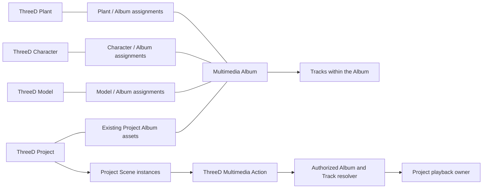

# v0.30.0 - ThreeD: Project Multimedia Player and Presentation

## Status and purpose

The Developer confirmed **v0.30.0 - ThreeD: Project Multimedia Player and Presentation** released to production on October 31, 2026. This exact Developer-supplied title supersedes the preparation title. The documentation follow-up began on clean `main` / `fbe7ee66`; that observation does not independently establish the exact deployed commit or new post-deployment browser acceptance. Package and both root lock versions remain 0.30.0. The completed centaur production smoke check and preparation evidence below are preserved.

## Stable v0.30.0 release preparation — October 31

The Developer completed the production smoke check of [v0.30.0-centaur](v0.30.0-centaur.md) and requested promoting this same implementation to stable **0.30.0**. The requested smoke check covered Multimedia playback and Project Save/reopen; this acceptance does not independently certify every codec, collision or Simulation scenario. Stable preparation began on `main` / `eaabf8f0`, preserving the unstaged production-confirmation documentation. Package and both root lockfile versions now agree at 0.30.0; dependencies and runtime code are unchanged from centaur.

Stable scope is the accepted consolidated Project Multimedia menu/player, assigned Album/Track preview, Assets synchronization, saved overlay/selection with paused restoration, Project-wide presentation preparation, neutral Multimedia toolbar icon, Scene/Tools labels and Multimedia Module-creation correction. Existing Model-specific playback and Simulation paths remain included with the evidence/limits recorded below. No mini player, additional Action executor or new relationship schema is introduced. Original Album SQL remains already applied; Assembly identity SQL remains unapplied and Learn SQL on hold. No live migration is required for this promotion.

Centaur passed fresh TypeScript, all 100 offline CI tasks, native mocked desktop/mobile checks and an isolated production build (164/164 pages), followed by the Developer's completed production smoke check. Stable release preparation is complete. Fresh TypeScript (`--noEmit --incremental false`) and all **100 credential-free offline CI tasks** passed. Guarded isolated `npm run build` passed on Next.js 16.4.3, including **164/164 pages**, exit 0. Matching prior clean-installed dependencies were reused after lock comparison; no active install/output or environment file was changed. The existing nested-workspace warning remains non-failing. Post-build parity passed for **1,221 source files, 14 non-generated root inputs and 73 tracked public assets**, plus copied documentation/CI inputs; generated `next-env.d.ts` is excluded after compilation. Subsequent edits record results in documentation only. All three version fields agree and remaining package/lock content matches HEAD. Schema inventory is unchanged; only generated metadata was refreshed. Logs/manifests: ignored `.next/release-0300-stable-tools`. Stable production deployment is Developer-confirmed above.

**Next Steps:** continue from this released checkpoint. This production-confirmation documentation remains unstaged; no agent staging, commit, push, live database operation, server start/stop or deployment was performed.

## Earlier checkpoint history

October 31 current checkpoint: the Developer requested accumulated Project Multimedia and presentation work be prepared as **v0.30.0-centaur**. Its current scope, acceptance, release gates and remaining limits belong to the [centaur release record](v0.30.0-centaur.md). Earlier alpha preparation statements below are historical; the complete v0.30.0 milestone remains open.

The Developer requested this starting checkpoint be prepared as **v0.30.0-alpha**. Current alpha scope, release gates and remaining limits are maintained in [its release record](v0.30.0-alpha.md). This resumes preparation for the alpha only; the complete v0.30.0 milestone remains open.

October 29 continuation: after confirming [v0.29.2](v0.29.2.md) released, the Developer authorized resuming this milestone. Work began on clean `main` / `f7cd38e6`, with package/root lock at 0.29.2. The Radio interaction continuation below owns current evidence; historical version/preparation statements remain below. Implementation is resumed, not production preparation for v0.30.0.

## October 31 — One Project Multimedia menu and player

After accepting Assets/preview synchronization, the Developer requested removing the separate floating player and merging playback into the toolbar's Project Multimedia overlay, as illustrated by the green preview area and red floating panel in the supplied screenshot. The menu now contains Album/Track selection, the current Album/Track and playback/error status, media video presentation and a single Play/Pause/Stop/Rewind/Next Track control group. The separate fixed player and its Close player action are removed. A future mini player is not implemented.

`SceneMultimediaProvider` retains ownership of the one playback engine and media element. The Project menu stays mounted while closed; the media element renders into its stable playback host, so closing/reopening the menu hides the controls without replacing the media element, clearing playback or losing the selected Track. Project/account changes still clear through the established scoped lifecycle. The closed menu is hidden and cannot take focus; opening focuses Close, and Escape returns focus to the toolbar. Selected Album/Track and current playback remain distinct while browsing; the controls can pause/stop current playback, and explicit Play starts the selected Track. **Show current Album** returns selection to the current Project Track. Model-specific Actions continue using the existing marker authority, while their playback status/controls are visible in the same Project menu. Assets synchronization, explicit Project Save and paused restoration remain in place.

The native local-file Edge fixture passed dark/1440px and light/375px with actual App CSS/components and mocked HTTP/media. It verifies the media element is inside the menu, one integrated player, exact DOM-element retention across menu close/reopen, continued playback, selection/status synchronization, Project Save/reopen paused, denied-play retry, account/Project isolation and retained Model/Design behavior. The first native attempt tried to return a React-owned DOM node through the debugging protocol; the fixture was corrected to retain the node in-browser and return a Boolean. Final artifacts: OS temporary directory `threed-multimedia-browser-9OWNHX`; the desktop capture was inspected. Fresh TypeScript and all 100 credential-free offline CI tasks passed. Actual production media codecs/streams and real-App acceptance remain separate.

**Next Steps:** open Multimedia, select and play a Track, close and reopen the menu, then confirm the same Track continues with no floating player. Check Pause, Stop, Rewind, Next Track and Project Save/reopen. No database, version, dependency, server or deployment operation; changes remain unstaged.

## October 31 — Project Assets Multimedia navigation and shared selection

The Developer requested moving Multimedia beneath its sibling Project Assets sections and connecting each Album to the Project preview/player. The Multimedia section now follows the existing marker, Architecture and file-warning sections in the Assets scroll area; pinned Sensor Tools retain their separate location. Each Album is an accessible preview button with shared selected state and current Project Track/playback status.

The existing `SceneMultimediaProvider` coordinates Album navigation: an Assets Album opens the Project toolbar overlay, closes Weather and preserves the selected Track when returning to the same Album. The shared player's **Preview Album** action opens its current Project Album/Track in that overlay. Next Track and playback status propagate through the same provider to Assets and the overlay; there is still one media engine. Browsing another Album does not autoplay or interrupt the current Track: selected Album and currently playing Album remain visibly distinct until explicit Play. Model-specific playback remains on its existing authority path. Account/Project isolation and Project Save's existing shared selection capture are retained. Track paging is keyed by Album so external Album navigation cannot carry a previous Album's page offset.

Native local-file Edge integration passed actual Assets, overlay and player components at dark/1440px and light/375px with mocked HTTP/media. It checks Assets highlighting/current Track after Next, Album-to-overlay navigation without autoplay, player-to-overlay exact Track navigation, one engine, Save/reopen, account/Project reset and retained Model/Design editing. The first fixture attempt omitted the Assets component due to a failed fixture insertion; after mounting it, the integration passed. After the paging correction, fresh TypeScript, all 100 offline CI tasks and the native integration passed. Final browser artifacts: OS temporary directory `threed-multimedia-browser-h7Y2Xz`. No live database/server operation, version change or deployment; changes remain unstaged.

**Next Steps:** open Project Assets, expand Multimedia at the bottom, select an Album and play a Track in its preview. Check Assets status, Next Track, the player's Preview Album action and Save/reopen. Real-App acceptance is pending.

## October 31 — Project-wide presentation preparation

The Developer accepted this preparation change. Subsequent toolbar refinements make only the Multimedia trigger icon inherit the neutral button color, rename the active Project toolbar's Environment menu/header to **Scene** (tooltip **Scene Controls**), and rename its **Setup** menu to **Tools**. Existing commands and saved identities are preserved.

The Developer accepted Multimedia overlay/Album/Track Save and reopening, then reported Project components appearing before the top-level ThreeD preparation finished. Inspection found the opaque loader was local to the 3D viewport, while Assets, Design panels and restored overlays were siblings outside it. Design mode also bypassed the existing toolbar readiness restriction. The Scene's initial readiness expression did not include its already-reported pending resources.

`ProjectPresentationBoundary` now owns one loading display across the Project workspace, receiving real progress and completion/failure from the existing `SceneResourceFeedback`. The Scene and panels remain mounted with their original geometry, resource and persistence owners; their shared presentation is transparent and inert until the existing Scene introduction completes. No second Canvas, timer-based success, renderer replacement or quality change was added. Pending reported resources now hold the initial Scene readiness gate; failed files retain existing fallback/warning behavior. Renderer/physics failure releases the covering display so the existing stopped/error surface stays accessible. Standalone Scene callers retain their local loader.

The boundary releases once per Project, so later marker/resource edits do not replay initial preparation. A Project change gets its own preparation state without keying/remounting children. 2D-only mode remains accessible without waiting for a visible 3D presentation; entering a 3D-bearing mode waits for Scene readiness if that Project has not completed it. Optional content loaded on demand still uses its own loading/error feedback; this change does not preload all possible menus, media bytes or remote services.

Focused offline presentation, Design and Character-introduction checks passed. An isolated local-file Edge fixture at 1440px and 375px passed whole-workspace coverage, progress, inert keyboard behavior, retained child mounts across Project changes, Scene transition completion under the hidden wrapper, post-load controls, failure access and 2D-only mode. Artifacts: OS temporary directory `threed-project-presentation-uQ9W7e`. The fixture uses actual App CSS and presentation components with mocked Scene readiness, not production Canvas/GPU/assets. Fresh TypeScript and all 100 credential-free offline CI tasks passed after these changes.

**Next Steps:** open an existing Project in 3D and Design modes and confirm Assets, Properties and the restored Multimedia overlay appear with the completed presentation. Verify selection/movement and Save still work afterward. Real-App acceptance is pending. No live data, server, dependency, version or deployment operation was performed; changes remain unstaged.

## October 31 — Save Project Multimedia workspace

The Developer accepted the Project Multimedia menu (“Looks and works good”) and requested saving its overlay and selected/current Album Track through Project Save. The existing version-1 `threeDViewState` now accepts a bounded optional `multimedia` object containing only `open`, `albumId` and `trackId`. Legacy snapshots remain valid; invalid IDs, Track-without-Album, playback flags and arbitrary media URLs are rejected.

The Project Save capture reads the current selection from the Project-owned media provider and includes the overlay state in the existing marker/architecture/workspace transaction. Dirty feedback includes these fields; failed or pending saves retain current edits. Selecting an Album/Track, closing/reopening the menu and using Next Track all retain the current Project selection. No independent Save endpoint, storage key, SQL migration or automatic persistence was added.

On Project load, the saved overlay state is restored and Album/Track IDs are revalidated through the existing Project preview authority. A saved Track from a later page resolves its current page by identity. The persistent player is prepared **paused** without invoking media playback; the user explicitly chooses Play. Playback time, playing status, URLs and collision bindings are not saved. Project/account isolation, denied-reference feedback and cancellation prevent stale restoration from replacing later user selection or starting playback.

Focused checks passed the actual mocked Project Save → API transaction → GET/session → Dashboard hydration, strict parser bounds/legacy compatibility, Multimedia dirty feedback and paused restoration. Native Edge passed open/closed-overlay and selected Track restoration at dark/1440px and light/375px, including Next Track updating the captured current Track, no autoplay and existing Model/Design behavior. Artifacts: OS temporary directory `threed-multimedia-browser-MoYZ5F`. The earlier native fixture needed a stable loaded Track page during selection revalidation; the selector now retains that page while the chosen identity is checked.

Fresh TypeScript and all 100 credential-free offline CI tasks passed. The first full run exposed a Character Save fixture missing the new snapshot inputs; the fixture was updated, then the complete suite passed.

**Next Steps:** select an Album/Track, choose **Save ThreeD Project**, then reopen the Project. Confirm the overlay and Track return and playback remains paused until Play. The Developer subsequently confirmed this Save/reopen behavior works; no agent live database/server operation or deployment was performed. Package/root lock remain 0.30.0-beta and changes remain unstaged.

## October 31 — Project toolbar Multimedia preview

The Developer confirmed that Project Album assignments are working so far and requested a Project Header Toolbar Multimedia menu similar to Weather, independent of Model relationships. The new **Multimedia** button opens Project Albums, search/paging, Album information and an explicit Track selector with Play/Pause/Stop/Rewind/Next. It is available in editable and read-only Project headers. Selection and opening do not autoplay; Escape/Close returns focus to the trigger. Weather and Multimedia panels close each other when toggled.

The existing `/api/project/multimedia-albums` supplies assigned Albums. The new read-only `/api/project/multimedia-preview` validates Project access and the exact Album through active owned `project_assets`, `project_multimedia` and Multimedia Module membership. Owners can preview their assigned Albums; other viewers require public/published Albums. Tracks must be active and owned by the same Album owner, with bounded Sort Order paging and explicit Track membership revalidation. Safe DTOs omit private metadata. No Model, marker or reusable ThreeD Album association is needed or consulted for this path.

Project preview uses the existing Project-owned media element and shared playback core through a separately validated Project command. It does not fabricate a marker or relax Model/Character command checks. Manual Project preview interrupts an active Multimedia Simulation through its existing cancellation boundary before taking over the engine. Project/account changes clear playback and the browser's selection/data; aborted or stale reads cannot start a new Track. Closing the menu leaves the persistent player available; Close player stops it. No Canvas, Rapier, geometry, Design selection, Save/history, schema or dependency change was introduced. Package/root lock remain 0.30.0-beta.

Validation: actual-service SQL compilation/mocked persistence checks passed Project ownership, active Module/asset membership, public gates, safe serialization and exact Track paging. Shared-player checks passed Model/Project switching, Layer-independent Project preview, late Project-response rejection and Simulation interruption. Native Edge passed the actual React/App CSS UI at dark/1440px and light/375px: Project-only Album preview without Model selection, paging, no autoplay, explicit Track playback, one engine, failure/retry, Escape/focus and account/public reset. Desktop/mobile captures were inspected. Existing Model playback, Simulation result retry and Design Model/wall editing regressions also passed. Artifacts: OS temporary directory `threed-multimedia-browser-UFmKGU`.

Fresh TypeScript and all 100 offline CI tasks passed. The first full run exposed an older toolbar fixture missing the new button dependency; the fixture now supplies that boundary and checks the menu callback explicitly. The complete rerun passed. A later test-only addition verifies the actual Simulation interruption callback and passed focused revalidation. No live database/media/physics operation or new production build was performed. Actual App/codec/autoplay acceptance of this menu remains pending; the Developer's earlier acceptance covers Album assignments, not this new preview UI.

Final native rerun also waited for enabled playback controls before capture and passed both widths/themes plus existing Design checks; artifacts: OS temporary directory `threed-multimedia-browser-XhICSM`. Documentation/lock checks passed 480 paths/anchors and whitespace checks passed.

**Next Steps:** open the Project, choose **Multimedia** beside Weather, select an Album and Track, then Play. Verify Pause/Stop/Rewind/Next, close/reopen the menu and switch Projects. Changes remain unstaged; no agent commit, push, deployment or Developer-server operation was performed.

## October 31 — Project Multimedia Module creation

The Developer reported a failed Music Module creation from Project #15 and supplied its Create New Module screenshot. Source inspection found that `/api/multimedia` derived the globally unique Module slug solely from its display name. Reusing an existing name therefore produced a duplicate-key failure; Project template creation already used generated unique slugs. This conflict was reproduced with the original handler and mocked uniqueness enforcement. The original live request's HTTP response was not captured.

The creation route now trims and validates the name and generates a bounded readable slug base with a UUID suffix, following the existing Project-template approach. Existing Module names, slugs and relationships are preserved. The Project form's type option/Module label and relevant creation/assignment errors now use **Multimedia**. No schema, migration, dependency or version change was needed; package/root lock remain 0.30.0-beta.

`validate-project-multimedia-create.cjs`, included in the existing `project-configurations` CI task, executes the actual creation/assignment handlers and Project form callback with mocked DB/HTTP. It checks repeated names across owners, unique slugs, private/active owner defaults, invalid/unauthenticated rejection, Project/Module ownership, duplicate assignment, create-then-attach identity, success refresh and failed-creation behavior. The original handler fails the duplicate-name regression; the corrected handler passes. Focused Project, Multimedia authority and Album checks and fresh TypeScript passed.

The Developer subsequently confirmed: **“The label changes to Multimedia and now works.”** This establishes actual App acceptance of the reported creation workflow; it does not certify broader playback or collision behavior. No agent live database operation, server start/stop, commit, push or deployment was performed. Changes remain unstaged.

Final gate: the full 100-task offline CI group passed, including the new regression within Project configuration checks. The log is retained at ignored `.next/project-multimedia-create-2026-10-31.log`. Documentation/lock and whitespace checks also passed; no release build was requested or run.

**Next Steps:** continue assigning the intended Albums to the Project and verify its Radio interaction through the existing workflow. No SQL rerun is required for this fix.

## Post-v0.29.2 Radio interaction continuation

Concrete gaps: DetailsCard offered an Album selector without displaying its selected Album information; a denied Track switch changed the media source but left the previous Track in player state. The retry button could therefore request the previous Track. Playback completion and Stop also appeared as Paused.

Acceptance criteria: display the selected Album's existing safe information; keep the requested Track visible/retryable after failure; distinguish loading, playing, paused, stopped, ended and error; preserve the one Project media engine, command authority and accepted Design controls.

- `SceneMultimediaDetails.tsx` displays title, artist and available cover artwork inside its existing section, with current Track/status for the matching object and Album. Failed artwork is hidden without blocking controls.
- `scene-multimedia-player.ts` publishes the requested Track before awaiting browser playback, retains it on denial, and reloads an errored source on explicit retry after the existing authority read. Intermediate media events do not overwrite command status; queued pause events retain Stop/Ended/error status. Play still completes on playback start; no automatic next-track or timed Simulation step was added.
- `SceneMultimediaProvider.tsx` displays status, reports command validation failures instead of swallowing them, and allows closing an error-only player. The persistent media element and Project/session cleanup remain.
- Controller and native browser validators cover denied Track switching, retrying the displayed Track, unchanged-URL media retry, Stop/Ended status and Album information. Native fixtures retain the accepted Model Properties/movement/resizing and wall editing checks.

Validation: fresh TypeScript and focused Multimedia checks passed; seven Design/overlay/Simulation tasks passed. Native Edge passed actual React/App CSS at dark/1440px and light/375px with mocked HTTP/media, including single-engine lifetime, Project switching, Simulation capture/result retry and Model/wall editing. Initial artifacts: OS temporary directory `threed-multimedia-browser-IOAaYg`. These checks do not certify live codecs, browser autoplay permission, authenticated data or physical collision behavior. The two historical full-CI sidebar/Learn discrepancies remain; full CI/build were not repeated for this focused continuation.

Final focused gate: fresh TypeScript, Multimedia and repository-maintenance (473 documentation paths/anchors) passed again. The final native browser run also verifies Stop status after queued events and repeats the Design regression checks; artifacts: OS temporary directory `threed-multimedia-browser-rK9nO0`.

**Next Steps:** verify Design: Radio with its related, Project-assigned Album TRADE: select a Track, Play/Pause/Stop/Rewind/Next, and confirm the displayed Track/status. Then verify the existing controlled-Character/collision and Simulation paths described below. Assembly SQL remains unapplied, Learn SQL stays on hold, and no live/schema/version/server operation was performed. Changes remain unstaged.

## Earlier checkpoint history

October 29 checkpoint decision: the Developer requested the accumulated implementation as [v0.29.2-alpha](v0.29.2-alpha.md), preserving unresolved regressions for comparison. That file owns current alpha release preparation; the earlier halted-preparation/version statements below describe their historical checkpoints. v0.30.0 remains the unfinished broader milestone.

October 29 implementation: the Developer approved proceeding with the reassessed integration steps. The working tree now includes foundation corrections, Radio DetailsCard playback, session-armed collision Play and typed Multimedia Simulation execution. See the [current checkpoint](#october-29--authorized-integration-implementation) for evidence and limits. Real-App acceptance remains pending. Release preparation stays halted; package/root lock remain 0.29.1.

Documentation correction, October 28, 2026. The Developer reaffirmed that the App has always used its [Schema-First, Top-Down Module architecture](../plans/app-module-architecture.md). **ThreeD, Multimedia, Traffic and Learn** are peer Top Modules connected through many-to-many relationships. Existing schema identities, ownership and relationship contracts guide services/API, Admin controls and runtime behavior. This corrects the agent's understanding; it does not establish a new architecture or request a redesign. Earlier conflicting planning assumptions are superseded.

The Developer approved the **basic outline** of `docs/plans/app-module-architecture.md` on October 28, 2026. This records outline acceptance; the disputed Learn relationship and SQL remain on hold.

Observed worktree: `main` / `02c2447b`, with existing unstaged implementation and untracked files. Package and both root lock versions remain 0.29.1; Next.js is declared `^16.4.3`. Earlier documentation-only checkpoints are preserved below; newly authorized implementation is recorded separately. No live database operation, version bump or deployment was performed.

The original [threed-albums.sql](../developers/sql/threed-albums.sql) was successfully applied by the Developer; preserve it and its data. The retained [threed-albums-learn.sql](../developers/sql/threed-albums-learn.sql) is **on hold, not confirmed applied, and must not be executed as the next step**. It implements Guide-to-Album associations, which do not establish the Top Module relationship architecture. Neither that interpretation nor a new Learn Module-instance table is the agreed correction.

Next work is Developer verification of the implemented Radio/TRADE/Project workflow and review of the unapplied Assembly identity correction. A new architecture, root Module table or universal relationship store is not required. Earlier evidence remains historical; the current checkpoint separates implementation, offline checks and pending real-App acceptance.

Documentation checkpoint validation: the existing repository-maintenance check passed 460 documentation paths/anchors and its existing navigation/package-lock contracts. A focused check passed 38 plan/release/guide/architecture links, whitespace and unchanged 0.29.1 package/root-lock versions; Next.js remains locked at 16.4.3. `git diff --check` passed. Independent read-only review found no unsupported physical-schema approval in the documented plan. After the Developer clarified that this architecture has always existed, the plan and current status were corrected and documentation path/whitespace checks passed again. No runtime tests, browser checks, live operations or build were performed for this documentation update; changes remain unstaged.

## October 29 — Authorized integration implementation

The Developer approved the reassessment's next steps. This section supersedes pending implementation statements in the earlier review below; its findings and proposals remain historical evidence.

### Foundation corrections

- Preserved the applied shared Album table and existing Project Module/asset paths. Albums remain the relationship boundary; Tracks remain within Albums.
- Excluded the unaccepted Learn-guide Album path from the registry, editor and options API; removed its unused authorization helper. Learn CRUD/content and its peer Top Module identity remain intact. The retained Learn SQL stays on hold and must not be executed.
- Application validation/routes now accept Assembly text/UUID identities and positive numeric identities for the other 22 kinds. Prepared [threed-albums-entity-identity.sql](../developers/sql/threed-albums-entity-identity.sql) for manual review: it converts the existing junction identity to text, checks identity by kind, and compares cleanup IDs through `OLD.id::text`, preserving associations/indexes/triggers and the Module allowlist. **Not run or confirmed applied. Assembly support requires that reviewed follow-up; never rerun the original CREATE script.** Native conversion/cleanup remains unverified.
- Designs' header follows Project Multimedia management instead of treating Project IDs as catalog Design IDs. Existing catalog Design associations remain in the registry.
- Project Assets Album paging starts at page one when Project/search/account scope changes, retaining aborted/stale-response guards.

### Radio interaction, playback and Actions

The [Scene read service](../../src/libraries/services/threed/multimedia/scene-multimedia-read.ts) resolves the exact saved marker, active owned source and ThreeD assignment, intersects its Albums with active Project Multimedia assets/Module assignments, and applies existing owner/public visibility. Visitors require public/published Albums and active same-owner Tracks. Responses contain bounded safe fields, not private metadata. Explicit Track selection rechecks Album membership and locates its page.

**ThreeD > Project > Model > DetailsCard** now offers Album/Track selection and Play Multimedia, Pause, Stop, Rewind and Next Track. Scene instance coverage includes saved Models, Characters, Beds, FarmBots and Plantings; broad catalog Album authoring remains separate through the 23-kind registry. There is no implicit Plant/backing Model inheritance.

One Project-owned media element lives outside DetailsCard and Canvas. Closing/changing the inspector retains that engine; Project/session change, page close, unavailable/hidden target or Layer removal clears playback. Commands recheck read authority and exact target/Album binding. Rewind seeks to zero and preserves whether playback was running; Next advances within the Album without wrapping. Play denial/file errors are visible, and success requires the media promise plus actual unpaused state. No new Canvas, collider or mixer owner is introduced.

The controlled-Character button requires the exact saved, settled movable Character in interaction range. Collision Play can be explicitly armed for that Character/object for the Scene session. It consumes existing accepted Sensor/contact events, rejects ambiguous instances/wrong Projects, and suppresses duplicates/occupied entries with bounded re-entry throttling. It does not create Sensors/colliders, persist trigger bindings or bypass browser audio activation.

Typed Actions are `playMultimedia`, `pauseMultimedia`, `stopMultimedia`, `rewindMultimedia` and `nextTrack`; only Play accepts an optional exact Track. Existing version-1 Simulation definitions gain a strict optional Multimedia payload without a new column. Admin authoring selects the target's eligible Project Albums/Tracks. Scene runs support one exact Character/target pair, optional Run to target and Multimedia commands. Mixed Soccer kick/Multimedia sequences and other Action executors remain unsupported. Animation preview explains that media executes in the Project Scene.

The existing correlated runner waits for actual replies, captures owner Results before dispatch, retains public local runs, cancels on Stop/manual control/participant changes/timeouts, and finalizes once. Failed Result saves retain the report; retry only saves and never replays commands. **Play completes on playback start, not Track end.** Timed Wait/Track-ended execution is not included; an immediately following Pause pauses immediately.

### Verification and limits

- Seven final focused tasks passed: `threed-multimedia`, `threed-albums`, `threed-simulation-admin`, `threed-soccer-simulation`, `threed-simulation-launch`, `threed-simulation-results`, `learn-data-structure`. They exercise actual services/parsers/controllers with mocked persistence/media/React boundaries. SQL checks inspect the proposal without executing PostgreSQL.
- All 100 CI tasks were attempted across the initial run and resumed tasks: **98 passed across runs; two remain failing against preserved Developer edits.** `admin-sidebar` expects the removed public Learn link; `learn` expects the commented-out deletion/status footer. Their assertions were not weakened and those edits were not reversed. The Module appearance fixture now matches the manually capitalized **Save Module Appearance** label and retains failed-save assertions. Eleven environment/guard-affected tasks passed on retry: Windows `tsx` user-profile ENOMEM required an outside-sandbox run; the offline guard was corrected to allow local data/blob decoding and named-pipe IPC while blocking TCP/HTTP servers and live fetches. Credentials were scrubbed.
- Native Edge integration passed dark/1440px and light/375px with actual React components/App CSS, mocked HTTP/media and a local file/isolated profile. It checks Track choice/Play, one engine across inspector/Project changes, capture-before-dispatch, correlated completion, failed Result feedback and save-only retry. Screenshots were inspected with no horizontal overflow. Fixture startup needed an outside-sandbox retry and a browser `process.env` shim. This does not certify codecs/autoplay, Canvas/Rapier, authenticated CRUD or live playback. Artifacts: OS temporary directory `threed-multimedia-browser-O2ej68`.
- Schema explorer regenerated from current declarations: 86 tables, 1,230 columns, 164 FKs, 37 enums, 161 ORM declarations and 53 application mappings. Learn's unaccepted edge is excluded; Assembly is pending its manual follow-up. This is not live schema parity evidence.
- Fresh TypeScript passed during implementation; final source/documentation gates are recorded below. No live SQL/database/device/storage operation, server start/stop, dependency install, production build, staging, commit or deployment. Release preparation stays halted; package/root lock remain 0.29.1.

Final gate: fresh TypeScript (`--incremental false`), repository-maintenance (465 paths/anchors), standalone Learn public checks and `git diff --check` passed after the source hardening. The final native fixture passed again in both themes/widths against the same source; artifacts: OS temporary directory `threed-multimedia-browser-Db9jbp`. Current source gates leave the two documented manual-edit CI failures open. No isolated production build was run while release preparation is halted.

### Next Steps: Developer verification

1. Open saved Model **Design: Radio**, select **Multimedia Albums > Edit Albums**, assign **TRADE**, Save and reopen. The agent has not inspected live record IDs.
2. Add its saved Album to **ThreeD Garden Demo Project** through the active Multimedia destination. Confirm **Project Assets > Multimedia > TRADE**. Place the Radio through existing ThreeD assets and explicitly Save the Project.
3. Select the Radio, expand DetailsCard > Multimedia, choose TRADE/a Track and Play. Test Pause/Stop/Rewind/Next, inspector close/reopen, Layer hiding and Project switching. Public access must not reveal private Albums.
4. Take Control of the saved Character, approach the Radio and test the controlled-Character button. For collision, use the Radio's existing enabled Sensor/contact configuration, arm collision playback, exit/re-enter and confirm one Play per accepted entry. Arming resets with the Scene session.
5. Save a Multimedia Simulation using that exact Character/Radio, optional Run to target and Play Multimedia. Run in the Project Scene; test Stop, denied playback and owner Result save/retry. Consecutive Play/Pause commands execute immediately; direct controls allow listening between commands.
6. Review the unapplied Assembly identity SQL before claiming Assembly assignment/delete coverage. Keep Learn SQL on hold and preserve the original applied script. Resolve the two manual-edit validation failures before resuming release gates. Production preparation requires a separate Developer resume.

## October 29 — Scene selection and Properties follow-up

The Developer reported broken 2D Properties/selection highlighting and a lack of connection to the 3D surface in Project #17. The correction was **no corresponding object/response**, not selection of a different object. The screenshot also exposed the newly added Multimedia section compressed into DetailsCard's icon action row. These observations reopen real-App Scene acceptance; earlier mocked passes did not certify that Project's behavior.

Source review found competing selection paths: the embedded DesignEditor wrote its architecture selection directly, bypassing the Project callback that opens selected Properties; architecture picks could retain a Model inspector, while Scene Model picks could retain architecture selection. The 2D Model image received the selected instance ID but drew no footprint highlight. These are concrete source gaps; they do not establish the sole cause or introduction date of every reported symptom.

Corrections:

- The embedded editor now delegates selection to the existing Project selection callback. Architecture selection opens Properties and clears competing Model/incident/Sensor/Group/ground inspectors. Standalone editing retains its existing local path.
- Model picks on the geographic and 3D surfaces now use the existing Project asset selection callback, matching native plan image selection and clearing architecture selection. Stable placed-marker IDs remain distinct from catalog IDs.
- The selected Model's 2D footprint has a visible outline that does not intercept pointer input. This adds selection feedback, not direct dragging of catalog images or a new movement/persistence path.
- Multimedia is a full-width DetailsCard section outside the icon row. Canvas/Rapier ownership, geometry conversions, Project Save and existing drafts are retained.

Fresh TypeScript and four focused tasks passed: `threed-designs`, `design-appearance-top-view`, `threed-overlay-layout`, `threed-multimedia`. New offline coverage executes actual Project/editor selection callbacks, verifies exclusive selection/Properties expansion and preserves geometry/history/workspace. Existing selection fixtures gained the callback's actual inspector setters. An initial sandboxed `tsx` settings check failed with the known Windows user-profile ENOMEM error; the guarded, credential-scrubbed outside-sandbox retry passed. Full CI/build were not repeated for this focused correction; the two previously documented manual-edit failures remain open.

The native local-file fixture now mounts the **actual DetailsCard**, checking its full-width section alongside playback in both themes at 1440/375px. It also mounts actual DesignEditor/Project-controlled sections: collapse/reopen, pointer wall selection reopening Properties, numeric height edits and pointer dragging reach the same document and actual Three geometry owner. No Canvas/GPU, authenticated App, live Project or persistence was exercised. A first fixture run timed out because its legitimate dirty-Design navigation guard blocked switching test pages; running dirty-edit cases last corrected the test ordering without disabling the guard. Final native pass artifacts: OS temporary directory `threed-multimedia-browser-Tx8KBX`.

**Next Steps:** verify the existing Project in Design mode: select a wall in either surface, confirm matching highlight and Properties, change its height/position, then select a Model and confirm architecture selection clears and DetailsCard/2D footprint follow that instance. Native wall dragging updates shared geometry in the fixture; live Canvas/physics and the reported Project still require Developer acceptance. Preserve unsaved work before any reload. No server, database, schema, release version, staging or deployment operation was performed.

Subsequent Developer clarification: the remaining report concerns the **2D Design Properties panel and drawing canvas**, not the 3D Scene Canvas. After being asked whether the Wall button itself responded, the Developer confirmed: **“Now it does. Wall Tool now works.”** This establishes Wall Tool acceptance only; Properties and remaining-tool acceptance are not inferred. No further App code was changed during this clarification. The native local-file regression was strengthened to mount the actual DesignWorkspace split and use physical pointer clicks/hit testing on Wall, Floor, Roof, Door, Window and Select; all button activation checks and the existing Properties/drag/geometry checks passed. APIs remain mocked, no Canvas/GPU is mounted, and live Project state is not inspected. Final artifact directory for this check: `threed-multimedia-browser-RZKZKw` in OS temporary storage.

## October 29 — Integration reassessment and next steps

Historical read-only review; implementation status is superseded by the authorized checkpoint above.

### Objective and existing relationship path

Deliver the Developer's example: relate the ThreeD Model **Design: Radio** to Multimedia Album **TRADE**, assign that Album to **ThreeD Garden Demo Project**, then select the placed Radio in the Scene to see Album information, its Tracks and playback controls. The interaction belongs in **ThreeD > Project > Model > DetailsCard**. `Design:` is part of the Model name; it does not identify an architectural Design record.

The four peer Top Modules remain ThreeD, Multimedia, Traffic and Learn. This release connects the existing ThreeD and Multimedia domains through their actual records and Project assignments. The architecture does not require new root Module tables, a universal relationship table or every possible Module pair before this feature can work.

| Existing relationship | Meaning for this integration |
| --- | --- |
| `project_threed` / `project_multimedia` | A Project's assigned ThreeD and Multimedia Module instances. Their IDs are not Model or Album IDs. |
| `project_assets` | Explicit Project content membership: `module_type = multimedia`, the assigned Multimedia instance's `module_id`, `asset_type = multimedia_albums` and the Album's `asset_id`. Existing ThreeD Model assignments retain their own identities. |
| `threed_multimedia_albums` | Reusable ThreeD record-to-Album relationships. Here `module_type` is a sub-module discriminator, such as `model`; `entity_id` identifies that source record. Preserve the Developer-applied table and existing data. |
| `multimedia_tracks.album_id` | Tracks remain within their Album. Runtime Track selection does not require a new Model-to-Track or Project-to-Track relationship. |
| `project_threed_markers` | Saved Project placement identity, including stable `marker_id`, `marker_type` and `source_asset_id`. A placed Radio is distinct from its reusable Model record. |

These paths already express the needed integration. Follow the [established architecture](../plans/app-module-architecture.md) and [Project schema](../../src/libraries/schema/project/index.ts); appearance keys and route labels are not relationship authority.

### Effort so far: implementation versus acceptance

| Area | Current source evidence | Remaining acceptance or work |
| --- | --- | --- |
| Shared Album associations | [Registry](../../src/libraries/services/threed/multimedia/album-entity-registry.ts), [transaction service](../../src/libraries/services/threed/multimedia/album-associations.ts) and bounded revision-based replacement are implemented. | Original SQL application is Developer-confirmed. Real save/reopen and native deletion behavior are not independently verified. Registry exceptions below prevent claiming complete coverage. |
| Contextual Admin editing | [EntityAlbumsSection](../../src/components/admin/threed/multimedia/EntityAlbumsSection.tsx) and [EntityAlbumWorkspace](../../src/components/admin/threed/multimedia/EntityAlbumWorkspace.tsx) are mounted in numerous saved editors, including Models, Characters, FarmBots, Beds, Plants, Plantings, Scenarios and Simulations. | Keep the corrected broad scope. Verify real parent identity, draft retention and save/reopen. Learn's mounted Guide editor is disputed, not accepted coverage. |
| Add saved Albums to Project | The workspace rechecks saved association revisions and calls the existing `/api/project/assets` path with the selected active Project/Multimedia instance. It reports partial batch outcomes. | Browser roundtrip acceptance is pending. An authoring convenience does not define runtime inheritance or playback policy. |
| Project Assets > Multimedia | [Read endpoint](../../src/app/api/project/multimedia-albums/route.ts) and [panel](../../src/components/map/panels/ProjectMultimediaAssets.tsx) show assigned Album summaries through existing Project and owner/public gates. | Inventory presentation is implemented; Album/Track interaction and playback are not. Fix page-offset retention noted below. |
| Radio DetailsCard | Existing [DetailsCard](../../src/components/map/details/DetailsCard.tsx) owns the selected Scene object's interaction UI. | No Multimedia section or Project/Model Album resolver is connected. |
| Scene playback | Existing [MultimediaContent](../../src/components/multimedia/MultimediaContent.tsx) manages audio/video playback; [NowPlayingBar](../../src/components/multimedia/NowPlayingBar.tsx) has a separate store/player path. | No Project Scene playback owner is implemented. Reuse suitable existing code only after tracing its media-element lifecycle; the store alone is not the active Dashboard player. |
| ThreeD Actions / Simulations | [Target capabilities](../../src/libraries/services/threed/orchestration/action-target-core.ts) and [strict Simulation definitions](../../src/libraries/services/threed/simulations/simulation-input.ts) exist. | Multimedia commands are absent. The [Scene Simulation runner](../../src/libraries/services/threed/simulations/soccer-simulation-runner.ts) currently accepts only `runToTarget` and `kickBall`. |

The schema explorer in Learn and the Module appearance Save correction are supporting App improvements. Neither completes the Radio/Scene milestone. The native Learn explorer is present in source; its prior fresh TypeScript/focused checks and pending Developer verification remain separate from the standalone HTML's browser evidence.

### Focused corrections identified

1. **Keep the disputed Learn work on hold.** Current code maps `learn` to `learn_guides`, mounts Album controls in the guide editor and permits shared Super Admin Album selection. The original applied SQL excludes `learn`; source and proposed follow-up differ. Do not use the Radio requirement to justify that mapping, apply `threed-albums-learn.sql`, or invent a Learn Module-instance table. Before release, resolve that code path explicitly or exclude its availability without disturbing Learn CRUD/content.
2. **Repair the Assembly identity contract before claiming its support.** `threed_assembly.id` is text/UUID, while association IDs and route validation require positive integers. The applied generic cleanup trigger also compares integer `entity_id` with Assembly's text ID. This is a source-derived deletion concern, not an observed live failure. Propose the smallest compatible correction and any required follow-up SQL separately; retain existing data and do not rerun the CREATE script.
3. **Respect Designs' Project ownership.** `/admin/threed/designs` renders [DesignStandalone](../../src/components/threed/design/DesignStandalone.tsx), whose rows are Projects and whose edits use Project Save. The generic header instead maps its appearance key to `design` / `threed_designs` through [ModuleAlbumsButton](../../src/components/admin/threed/multimedia/ModuleAlbumsButton.tsx). Correct that entry point to follow the actual Project workflow; do not relabel Project IDs as Design IDs.
4. **Reset Project Album paging when scope changes.** `ProjectMultimediaAssets` retains `offset` when its Project/search props change. A later page can therefore appear empty for a new Project or search despite matches on page one. Reset the query scope and page together while retaining aborted/stale-response protection.
5. **Add a Scene read boundary rather than reusing private editor reads for visitors.** Current entity association handlers are authenticated owner-editor paths. The Scene resolver must combine Project readability, source placement identity, Album membership and existing [Multimedia access rules](../../src/libraries/services/multimedia/access.ts), returning only allowed Album/Track fields. Public Project visibility must not publish private Albums or inactive Tracks.

These findings identify work; this review does not change application code, schemas or SQL. Passing mocked adapter tests does not prove that every registry type works against real primary keys or database triggers.

### Delivery order

1. **Correct and verify the relationship foundation.** Address the named identity/entry-point/paging issues, preserve all supported ThreeD sub-module authoring and establish the Radio/TRADE save-and-reopen path. Keep disputed Learn changes out of the required demonstration. Any persistence correction needs its own concrete review before application.
2. **Build the Radio interaction in DetailsCard.** Resolve the selected stable Project marker to its Model source, show related eligible Album information and load Tracks only for the chosen Album. Reuse Project Assets membership and existing public/owner serialization. Preserve other DetailsCard sections and selection behavior.
3. **Add one Project Scene playback owner.** Implement Play, Pause, Stop, Rewind and Next Track using the existing media/file-delivery rules. UI selection must not instantiate a second media engine. Define cleanup on Project change and unmount, show playback failures and handle browser audio activation explicitly. Preserve the persistent Canvas/Rapier world.
4. **Expose playback through typed ThreeD Actions.** The button and Character/target interaction must use the same command path. Validate Project, source/target marker, Album and Track identities. Add collision triggering with bounded contact/re-entry behavior after button playback is proven, retaining current world-action completion/cancellation rules.
5. **Extend Simulation execution.** Add validated Multimedia command parameters and actual execution/result handling through the established runner boundaries. Preserve existing definitions, capture-before-dispatch, cancellation and immutable Results; adding an option to the editor is insufficient.
6. **Complete release verification.** Verify authoring roundtrips, owner/public access, denied or missing media, playback controls, Project switching, repeated clicks/collisions and Simulation outcomes, followed by applicable offline regression checks, fresh TypeScript and an isolated production build. Release preparation remains halted until the Developer resumes it.

**Proposed playback availability rule, still requiring confirmation before runtime implementation:** offer the selected object's related Albums that are also assigned to the current Project and readable by the viewer. Show a clear unavailable state for missing Project assignments; do not silently add assets or merge parent/sub-module repertoires. The Developer established both relationships; their precedence/inheritance has not yet been accepted as a general runtime policy.

### Human verification outline

For the existing authoring checkpoint, use owned test records with the Developer's example names below. This audit did not inspect live records or establish that those exact named fixtures already exist:

1. Open **ThreeD Garden Demo Project** and confirm its active ThreeD and Multimedia Module assignments.
2. Open the saved Model **Design: Radio**, choose **Multimedia Albums > Edit Albums**, select **TRADE** and save the Album assignments.
3. Use **Add saved Albums to a Project** for that Project's intended Multimedia instance, or its existing Project Assets assignment workflow.
4. Reopen the Model and Project; verify the saved Model relationship and **Project Assets > Multimedia > TRADE** separately.

After the runtime work above, extend verification by selecting the placed Radio, confirming TRADE and its Tracks in DetailsCard, then testing Play/Pause/Stop/Rewind/Next. Character interaction, collision and Simulation checks follow that same working example. These runtime steps are acceptance targets, not currently working instructions.

Review evidence, October 29: `npm run validate -- threed-albums` passed all three existing service/authoring/contextual validators with mocked persistence, network/session and React boundaries. Repository-maintenance passed 465 documentation paths/anchors; a focused check passed 117 release/plan/context links, whitespace and unchanged version checks. `git diff --check` passed. No new browser, database, playback or production acceptance is claimed. Existing Developer edits remain unstaged; package/root lock remain 0.29.1.

## October 29 — App Settings Save Changes correction

The Developer reported that changing Learn's Module color did not activate the page's Save Changes button. The Module appearance editor owned a separate draft and Save action; the page footer tracked only personal workspace and browser Scene appearance drafts.

The existing Module draft logic now lives in `useModuleAppearanceEditor`, consumed by SettingsManager and its Module appearance section. The page footer includes Module edits in its dirty state and saves them through the unchanged Module appearance provider/API. Its Discard and confirmed Refresh also include Module drafts. The section's existing Save Module appearance action remains available. Super Admin authority, revision conflicts, failed-save draft retention, personal preferences and browser-only Scene appearance keep their existing owners. No schema, API or persistence expansion was made.

Focused `module-appearance` and `workspace-settings` validations passed with mocked hooks/network/persistence. Regression coverage performs an actual Learn color edit, activates the footer action, verifies successful save/dirty reset, failed-save retention, busy/permission gating, no unrelated personal write, shared Discard and Refresh confirmation. Fresh TypeScript (`--incremental false`), repository-maintenance (464 documentation paths/anchors) and `git diff --check` passed. Developer browser verification is pending. Release preparation remains halted at the Developer's request; version remains 0.29.1 and changes remain unstaged.

## Data structure visualization

At the Developer's request, the [interactive schema explorer](../developers/app-data-structure.html) visualizes the existing structure from the current working-tree Drizzle declarations. Its [Markdown inventory](../developers/APP_DATA_STRUCTURE.md) and [JSON snapshot](../developers/app-data-structure.json) cover 86 tables, 1,230 columns, 164 foreign keys and 37 enums. The four Top Modules remain ThreeD, Multimedia, Traffic and Learn; Projects, Accounts and Settings appear separately as shared foundations.

The explorer provides table/column search, domain filters, complete column and constraint details, incoming/outgoing relationship lists and a navigable relationship diagram. Database foreign keys, 54 reviewed application mappings and 161 ORM declarations use distinct layers. Composite foreign keys retain every participating column. Application mappings come from the actual Project Assets, saved-marker and Album registries. JSON/JSONB columns remain opaque; this is not an inventory of all nested runtime objects or an assertion about the live database.

The local generator loads only schema modules and Drizzle through an allowlist. It checks exported table/enum coverage, relationship endpoints, embedded JSON integrity and generated-file freshness. The HTML runs directly from disk without a server, external dependencies or database access. Regeneration instructions are in the inventory. No App behavior, schema, SQL, package version or live records were changed for this visualization.

Source findings are labeled rather than silently corrected:

- The pending `learn` Album mapping is displayed as disputed/on hold. Its follow-up SQL remains unconfirmed applied.
- The Album registry maps `assembly` to `threed_assembly`, whose primary key is text/UUID, while the association's `entity_id` is integer. The explorer marks that application link as incompatible. The original applied SQL also installs the generic cleanup trigger on Assembly; its integer-to-text comparison is a source-derived deletion concern, not an observed live failure. A focused correction requires separate review; no migration or live test was performed.

Visualization validation: schema generation and `--check` passed, including complete embedded JSON comparison. Independent source review checked all 86 tables and 37 enums and the actual registry destinations. Local Edge tests passed 34 assertions at each of desktop and narrow widths: search/filtering, all tables/enums, representative column sets, composite foreign keys, graph pagination, relationship layers, pending/incompatible labels, theme switching and absence of document horizontal overflow. Direct-file desktop/narrow screenshots were inspected. Initial checks exposed embedded-JSON replacement-token corruption and a narrow grid overflow; both were corrected before the final pass. Browser startup required an outside-sandbox retry with isolated temporary profiles; no App server or live service was used.

Repository-maintenance, focused documentation links and whitespace checks passed. These results validate the local documentation artifact, not App browser acceptance, live schema parity, Scene playback or production readiness. Changes remain unstaged.

## Preserved earlier planning and implementation record

The sections below retain previous feature proposals, implementation observations and validation evidence. They are historical reference, not current implementation instructions or fresh authorization. The established App architecture takes precedence wherever they conflict; any further change must follow existing schemas and contracts.

Connect Multimedia to the existing ThreeD Project Scene through Album relationships and targeted ThreeD Actions. A Character should be able to interact with a Box and play Multimedia, then Pause, Stop, Rewind or select the Next Track. The same command path should support an accessible button, a configured collision interaction and a ThreeD Simulation.

## Earlier shared Album relationship design

An earlier Developer correction superseded the entity-specific junction and initial coverage proposals preserved below. **One shared `threed_multimedia_albums` table** stores `module_type`, `entity_id`, `album_id`, Sort Order and timestamps, with a unique (type, entity, Album) key. There are no Model/Character/Plant-specific Album tables. Projects continue to use **existing `project_assets` Album assignments**, displayed in the front-end under **Project Assets > Multimedia**. Track selection stays within Albums. This is the existing record-to-Album implementation, not the complete Top Module relationship design.

The fixed typed registry currently covers 23 catalog Sub-Modules: Model, Character, Plant, Planting, Bed, FarmBot, Scenario, Simulation, Design, Layer, Task, Harvest, Watering Schedule, Model File, Model Category, Texture, Ground Map, Animation, Animation File, Animation Category, Animation Slot, Animation Preset and Assembly. Logs, Results and internal junction rows are not independent authoring Sub-Modules. More catalog types extend the registry and database allowlist without introducing another relationship table. Plantings now have their own direct Album relationships rather than being limited to Plant inheritance.

Album IDs retain a real foreign key. Polymorphic entity IDs are validated against the fixed registry and locked with owner predicates before writes. The manual SQL adds parent-delete cleanup triggers for every registry entity, covering existing delete paths and cascades without broad CRUD rewrites. These triggers remove only association rows; they do not execute playback or physical commands. Direct SQL inserts do not gain a polymorphic FK guarantee and must not bypass the service's existence/ownership rules. The Drizzle table declares constraints; the custom cleanup triggers are separately maintained in the manual SQL.

**Project Assets is the Project-level source of truth.** Active Album assets must belong to an active owned Multimedia Module assignment. Entity Album repertoire intersects that inventory for Scene playback. No duplicate Project relationship table, automatic Track asset rows or silent on-placement assignment writes. A future explicit Add related Albums to Project action will use the existing assignment path. Existing legacy Project Track assets remain untouched.

## Earlier feature requirements

- This release is named **v0.30.0 - ThreeD Multimedia Integration**.
- Relationships between ThreeD entities and Multimedia are **many-to-many**.
- **Albums are the relationship boundary, not Tracks.** Every ThreeD Model must support Album relationships; assigning an Album is optional, not mandatory for every existing Model.
- Projects and Models can relate to multiple Albums; Albums can relate to multiple Projects and Models.
- Other ThreeD entities participate through their own ownership: a Character can relate to **Vocal Tracks of Farmer Kate**, and a Plant to **Plant Noises**. A Character's Album is not forced into its backing Model's metadata.
- **Play Multimedia** is a ThreeD Action and can be used in a ThreeD Simulation. Tracks are selected within an authorized related Album at execution time.
- The proposals below were written against these earlier feature requirements. Their field names, policies and phases are historical proposals, not established parts of the governing architecture or claims about existing functionality.

## Verified starting points

| Existing owner | Source and implication |
| --- | --- |
| Project/Module association | `src/libraries/schema/project/index.ts` defines `projectMultimedia` with Project ID, Multimedia ID, config and Active state. This joins a Project to the Multimedia Module, not directly to an Album. Preserve it; it does not replace entity-to-Album relationships. |
| Multimedia catalog | `src/libraries/schema/multimedia/index.ts` defines Albums and Tracks, including Track `albumId`, `trackNumber`, file reference and status. Album relationships must not duplicate Track records or files. |
| Read authority | `src/libraries/services/multimedia/access.ts` distinguishes owner reads from public published Album/active Track reads and bounds public serialization. Project publication alone must not publish private Multimedia. |
| Current Dashboard playback | `src/components/multimedia/MultimediaContent.tsx` owns selected audio/video elements and local playback coordination. `MultimediaPlayer.tsx` presents controls. The persisted store and `NowPlayingBar.tsx` are separate code paths; do not assume the store is the active Dashboard playback engine. |
| Project Scene | `src/app/dashboard/scene/page.tsx`, `UnifiedMapView.tsx` and `ThreeDScene.tsx` retain Project/session and Canvas/Rapier ownership. Extend these boundaries without another Scene or Canvas. |
| Actions | `src/libraries/services/threed/orchestration/action-target-core.ts` has explicit target capabilities; navigation/interaction and collision-point services already exist. Add capability checks rather than dispatching arbitrary action strings. |
| Simulation definitions | `simulation-input.ts` has strict version-1 definitions, bounded steps and explicit Action allowlists. New command parameters require a versioned, backwards-compatible contract. |
| Simulation execution | `soccer-simulation-runner.ts` explicitly supports only `runToTarget` and `kickBall`, using one Character/ball pair. Adding a dropdown option alone does not add execution support. |
| Results | Existing capture-before-dispatch, correlated outcomes, immutable snapshots and private owner Results must remain. Public runs stay local. |

See [Project configuration authority](../plans/project-configuration-authority.md), [Simulations](../developers/THREED_SIMULATIONS.md), [Characters](../developers/THREED_CHARACTERS.md) and [Runtime Markers](../developers/THREED_MARKERS.md).

## Relationship architecture

Phase 1 audit correction: reuse existing `project_assets` Album assignments for Projects; do not add a parallel Project/Album table. Use explicit junctions with actual foreign keys for newly supported ThreeD catalog entities, following existing schema conventions. Proposed initial coverage: Projects, Models, Characters and Plants. Inventory remaining ThreeD Module entities before schema approval and document which are supported, inherited or deferred. The many-to-many requirement is not limited to Models; it also does not imply every unrelated table needs a media picker.

Each junction should have unique entity/Album pairs, indexed foreign keys and server-enforced ownership. Propose per-assignment Sort Order and optional Active state only if required by the agreed editing contract. Use existing Sort Order conventions; do not use record IDs as ordering fields. No new direct Model/Track, Character/Track, Plant/Track or Project/Track relationship tables. Existing legacy Project Track assignments remain intact but do not authorize this feature; Scene Multimedia resolves through Albums.

For new catalog associations, prefer explicit typed junctions over an unconstrained `entityType/entityId` association that cannot enforce foreign keys. Exact table/column names, deletion policy and migration statements will be proposed after the schema audit, before implementation. Adding associations is requested product scope, but this planning turn does not execute or apply schema changes.

### Project availability and instance identity

Recommended policy for review: a Project's assigned Albums form its explicit Scene playback inventory. An entity's Album assignments identify that entity's available repertoire. A placed entity can play Albums in the intersection, subject to current read authorization. An editor can explicitly add a missing Album to the Project; placing an entity never silently writes Project assignments.

Show the reason when an entity Album is not available in the current Project. This avoids silently hiding valid Character/Plant assignments while retaining Project control. Confirm this intersection policy before implementation; the Developer has established both relationships but has not yet specified their precedence.

Catalog assignments and placed-instance configuration are distinct. Stable Runtime Marker IDs identify the actual Box, Character or Plant instance. Two instances of one catalog Model may select different related Albums for their controls without changing the catalog relationship. An instance override may select among permitted relationships; it must not introduce a direct Track relationship or bypass Project/Album authorization.

Keep Character, Plant and backing Model assignments visibly attributable. Recommended default: explicit entity Album selection wins; Model fallback requires an explicit inheritance choice, not an invisible union. Project ambience uses the Project's Albums directly. No automatic playback on placement, Save, load, hydration or publication.

## Authoring and API workflow

1. Create Albums and Tracks in existing Multimedia CRUD; reuse existing files and publication controls.
2. Assign one or more Albums in the owning ThreeD Project/Model/Character/Plant editor. Show title, access/publication status, Sort Order, unlink and clear empty/error states. Preserve existing editor Save/draft/conflict behavior.
3. Add reciprocal relationship visibility to the Album editor using bounded owner-scoped queries. Reuse one association service; do not build a second source of truth.
4. In **ThreeD > Project > Model > DetailsCard**, configure a placed Model's Multimedia interaction. Other entity inspectors use their existing owners. Show related Album choices, trigger mode and allowed commands without renaming DetailsCard or inventing a separate Character settings panel.
5. Choose Album, then an optional starting Track within that Album. UI distinguishes record identity from Track number: “Track #1” is not necessarily database ID 1. Store a stable Track identity in a command parameter only when an exact Track is requested, and revalidate Album membership on execution.
6. Save configuration through the existing Project snapshot/configuration transaction and typed changed-key merge. Keep runtime time/progress/playing state out of Project persistence.

Private CRUD must validate the current owner, both relationship endpoints and stale revisions; use transactions for replacement sets and reject duplicate/unknown IDs. Provide bounded search/paging rather than fetching entire catalogs. Public Scene projections expose only eligible Albums/Tracks and necessary presentation fields; no private metadata, owner IDs or durable signed storage URLs in snapshots. Exact routes and payloads remain to be designed from existing API conventions, not assumed here.

Deleting/unlinking an Album removes or invalidates its associations without deleting ThreeD content. An unavailable Album/Track disables the binding with a clear repair path; never substitute an unrelated Track. Final deletion/FK behavior needs explicit schema review. Recheck authorization on playback resolution and file delivery; stale browser state is not permission.

## Runtime playback and control contract

Introduce one Project-session playback owner outside the R3F render loop. It owns media elements, command serialization, request tokens and cleanup; Scene objects and DOM controls are adapters. Reuse proven Multimedia parsing, file delivery and controls where appropriate. Avoid mounting a separate full Dashboard player per Model or coupling playback lifetime to DetailsCard expansion.

Proposed first release: one audible Project channel, with the latest accepted Play request replacing the prior session after cancelling its pending callbacks. Commands carry Project/session, source marker, Album and request identity. Pause/Stop from an old object must not affect a newer object's session. Keep ownership explicit and reject or mark superseded commands. Multiple independent spatial emitters are a later capability.

| Control | Proposed deterministic behavior |
| --- | --- |
| Play Multimedia | Resolve the selected related Album and requested/default eligible Track; acknowledge only after actual playback starts. Repeated Play on the same session resumes without resetting position. |
| Pause Multimedia | Pause the current owned session and retain position. Repeated Pause is harmless. |
| Stop Multimedia | Pause and reset to the beginning; retain Album selection. Invalidate pending Play/seek work so it cannot restart. |
| Rewind Multimedia | Seek to zero while retaining playing/paused state; use this explicit initial meaning rather than an ambiguous backward-seek amount. |
| Next / Previous Track | Move within the current Album's stable eligible Track order; preserve playing/paused intent. Do not jump into another Album. Disable at boundaries; no wrapping by default. |
| Volume / Mute | Local playback controls with bounded values; not required Simulation Actions in the first milestone. |

Use existing Track ordering semantics, with a deterministic tie-breaker and documented handling of null Track numbers. Snapshot the eligible queue for an active session; revalidate references on changes. Proposed end behavior: advance within the Album and stop at its end; do not borrow Dashboard cross-Album advancement implicitly. Empty Albums and unsupported file types produce explicit unavailable states.

First milestone targets audio Tracks. Video Tracks must show a deliberate unsupported state until a video presentation contract is approved; existing Dashboard video remains unchanged. Spatial audio, video textures/screens, Lyrics overlays, playlists spanning Albums and network-synchronized playback are deferred, not implied by the release title.

Browser playback can reject without an allowed user gesture. A physics collision is not a browser gesture. Offer an explicit Enable Audio/Play control, handle `play()` rejection and show a blocked state; do not report success or endlessly retry. A prior click is not a guarantee across browsers. Reference: [HTML media playback specification](https://html.spec.whatwg.org/multipage/media.html) and [MDN autoplay guidance](https://developer.mozilla.org/en-US/docs/Web/Media/Guides/Autoplay).

Stop/release the owned session on Project change, logout, source removal or access loss. Hiding the source Layer suspends its interaction and pauses its playback; revealing it does not auto-resume. Preserve the persistent Canvas, physics world and unrelated markers. Handle expired delivery URLs through the existing authorized file path and explicit Retry; never persist signed URLs. Playback telemetry must not call the history/play-count write endpoint merely because a collision was observed. Any telemetry integration requires a separate explicit policy and deduplication; public Simulation runs do not write Results.

## Buttons, collisions and Character Actions

All entry points dispatch the same typed Multimedia command and receive the same correlated acknowledgment. A visible DOM button remains available for keyboard/touch access and autoplay recovery. A 3D button must distinguish activation from camera drag/placement and respect current Scene editing/control mode.

Collision triggers are opt-in per placed instance and filtered to the configured Character/target pair. Trigger once on enter, rearm after exit, deduplicate multiple colliders and bound rapid repeats. Do not dispatch every physics frame or trigger on initial restored overlap before arming. A collision alone never grants media access.

A Character-targeted **Play Multimedia** Action follows existing approach, facing, readiness and cancellation paths. Reach the exact target before dispatch. Default effect timing remains the established completion gate; a precise contact-time “press button” effect needs a separately defined correlated interaction contract. Do not reuse the Soccer kick exception indiscriminately or manipulate mixers outside their owner. A non-rigged Box can be a control target without pretending that the Box performed a Character animation.

The selected Album may belong to the target Box or the actor Character, with explicit authoring selection and permission checks. This supports both “Farmer Kate plays the Box's Album” and “Farmer Kate speaks from her Vocal Tracks Album.” Plant interactions similarly resolve Plant Noises through the Plant's Album assignments. Never guess the sound source from whichever object is currently selected.

## Simulation integration

Add a narrow Multimedia executor behind the existing lifecycle boundaries. Preserve the tested Soccer executor; do not broaden it by merely removing its allowlist. Route a validated definition to supported executors and reject unsupported combinations before starting. General cross-Project Simulation reuse remains deferred.

Design a versioned step contract with typed Multimedia operation, source selection, Album reference, optional in-Album Track selection and explicit completion policy. Read existing version-1 definitions/results unchanged; new writes use the approved version only. No arbitrary URLs or unbounded JSON command bags.

Proposed default Play completion is **playback started**, so Pause/Stop can be subsequent steps. An explicit **wait until Track ends** mode is optional and bounded by the step timeout; label it distinctly. A demo requiring an audible interval before Pause needs an explicit bounded duration/wait contract rather than a race between adjacent immediate steps. Confirm that small scheduling addition during contract review.

Capture owned runs before dispatch, including resolved Album/Track identity and binding revision in a bounded server-authorized snapshot. Subscribe before issuing commands. Correlate replies to run, step, request, Project, actor and target. A blocked Play becomes an actionable failure under the existing stop/continue policy, not a completed step. Preserve cancellation, timeout, terminal finalization and save-only retry. Result retry never replays audio.

On Stop/cancel, stop only playback owned by that run; a late result cannot restart it or interrupt a newer manually started session. Proposed successful-run cleanup also stops run-owned playback; ongoing ambience after completion requires an explicit later policy. Reports describe observed browser playback, not proof that a human heard audio. Capture bounded outcomes and error reasons, not raw media or signed URLs. Public runs retain transient outcomes only.

## Delivery phases and acceptance gates

| Phase | Deliverable | Required evidence before proceeding |
| --- | --- | --- |
| 1. Contracts and schema proposal | Entity coverage matrix; explicit Album junction design; Project/entity precedence; command/result versioning; ownership and deletion rules | Reviewed examples for Project, Model, Farmer Kate and Plant; approval of exact persistence expansion and migration proposal |
| 2. Album assignments | Schema/API integration, bounded pickers and reciprocal Album relationship views | Owner isolation, duplicate handling, invalid IDs, transactional updates, drafts/conflicts and private/public projection checks; Developer applies approved SQL separately |
| 3. Project button milestone | One Project playback owner; Box/DetailsCard button plays a Track from its related Album | Actual audio starts; Pause/Stop/Rewind/Next/Previous behave correctly; Save/reopen retains bindings without autoplay; browser blocked/error/retry cases |
| 4. Character and collision milestone | Targeted Action and opt-in collision adapters using the same commands | Exact actor/target, one enter/one request, multiple colliders, exit/rearm, navigation cancellation and source/Layer removal; no remount or animation regression |
| 5. Simulation milestone | Supported executor dispatch, versioned definitions and bounded playback outcomes | Capture-before-dispatch, correct start/end completion, Stop/timeout, stale reply rejection, result-save retry without replay and public local-run isolation |
| 6. Release preparation | User/developer guides, acceptance record, package/lock 0.30.0 and release checks | Fresh isolated TypeScript, focused tests, applicable full CI, guarded isolated build, source parity and Developer browser acceptance |

### End-to-end acceptance examples

1. Relate Album A to Project P and Box Model M. Place M twice; both retain distinct marker identity. Choose a Track within A and use the first Box's Play button. Confirm controls affect the intended session and a stale control cannot stop the second Box's newer playback.
2. Relate Vocal Tracks of Farmer Kate to Character Kate and the Project. Run a targeted speech/play interaction using that Album without changing Kate's backing Model or creating a direct Character/Track link.
3. Relate Plant Noises to a Plant and the Project. A configured Character interaction plays one selected in-Album sound; unrelated physics contacts do nothing.
4. Reuse one Album across multiple Models/Characters/Plants and Projects. Unlinking one association leaves all other entities, Album contents and associations intact.
5. Run a Simulation with approach, Play, a defined audible interval, Pause, resume and Stop. Check ordered outcomes, cancellation during approach/loading, and no hidden playback after leaving the Project.
6. Test a public Project with public eligible media and then with a private/unpublished Album. No private media or metadata leaks; public playback never creates private Results.

## Validation and release limits

Add focused fixtures for relationship authorization, versioned parsers, playback state transitions with mocked media promises, collisions with multiple contacts, stale commands, queue boundaries and result snapshot/finalization. Exercise late Play resolution after Stop, media errors after successful start, missing/deleted/moved Tracks and pending requests during Project switches. Keep database, storage and device boundaries mocked for automated checks.

Run existing Multimedia, Model/editor, Project Save/configuration, Runtime Marker/Layer, orchestration and Simulation regression tasks. FBX/assets, idle/walk/run, Garden movement, Ecctrl WASD, DetailsCard, Take/Release Control, Water/Pick Fruit and Soccer contact behavior remain release-blocking. No physical-device actions or new FarmBot integration.

Browser acceptance includes desktop and touch controls, blocked autoplay, supported audio codecs, real loading/seek/end behavior, dark/light layouts and navigation cleanup. Automated mocked success is distinct from browser acceptance, manual SQL application and production confirmation. Next.js 16.4.3 needs the current release's own isolated build evidence; prior 16.4.2 checks do not certify it.

No App code, package version, schema or live data changes are made by this plan. Do not run full `db:push`, seed/demo imports or production deployment as validation. Prefer additive schema and code rollback that retains assigned data; finalize rollback behavior with the migration proposal.

## Initial decisions carried into Phase 1

- Complete supported ThreeD entity list and exact FK-backed junctions.
- Confirm Project Album inventory as the explicit availability gate, plus Character/Plant/Model inheritance precedence.
- Confirm one audible channel, same-Album queue boundaries, Rewind-to-start and run-completion cleanup defaults.
- Confirm audio-only first milestone and whether video/spatial sound belongs in a later release.
- Confirm bounded wait/duration semantics for audible Simulation demonstrations and any contact-time interaction exception.

## Planning evidence

Source/schema review completed against the baseline above. This is a proposed implementation plan incorporating the Developer's Album-only many-to-many corrections, not a claim of implemented relationships or playback. Implementation checks, SQL acceptance, browser acceptance and release validation remain pending.

## Historical Phase 1 proposal (superseded by shared relationship table)

The Developer authorized continuing the planning next steps. This section refines the initial plan using the schema/API audit; it does not apply database changes. The following decisions are recommended implementation defaults, with the new schema proposal awaiting approval.

### Existing Project relationships: reuse, do not duplicate

The deeper audit found an existing many-to-many Album path in `project_assets` (`assetType = multimedia_albums`, `moduleType = multimedia`). The unique key includes Project, Module, asset type and asset ID. `ProjectAssetManager.tsx` already exposes Albums, and `/api/project/assets` validates the owned Project, compatible asset registry and active Module assignment on creation. `projectMultimedia` remains the Module association.

Use this path as the Project's Album inventory. A Project may contain multiple Multimedia Module assignments; preserve their identity and deduplicate Album IDs only in the playback projection. Revoking one assignment does not remove another valid assignment. Resolve only active assets through active owned Module links. Read/delete/replacement paths must receive the same ownership review as creation before implementation is accepted.

The same existing asset manager exposes Track assignments. Preserve those existing rows and workflows; they are not used as permission for ThreeD Multimedia playback. Do not migrate or delete them implicitly. Album-only is the contract for this new integration.

### Entity coverage matrix

| Entity | Association in this release proposal | Runtime interpretation |
| --- | --- | --- |
| Project | Existing `project_assets` Album rows | Project availability and optional Project-level controls |
| Model | New explicit Model/Album junction | Any Model source, including supported Shape/Box, can expose controls through its placed instance |
| Character | New explicit Character/Album junction | Character-owned repertoire, independent of backing Model |
| Plant | New explicit Plant/Album junction | Plant-owned repertoire, independent of backing Model |
| Planting | Inherit explicitly selected Plant Album capability through the actual Plant reference; no new junction initially | Retain Planting marker identity and validate its Plant relationship; do not treat Plant ID as marker ID |
| Beds, FarmBots and other placeable entities | Deferred direct Album junctions; retain extension boundary | No implied physical-device command; a related Model is not automatically permission to play |
| ThreeD Module root, Designs, Layers, Scenarios, Tasks, Harvests and schedules | No direct Album junction in the initial implementation | Project context, presentation or orchestration retain their existing role |
| Simulations | Versioned steps reference resolved Album bindings | Execution definitions, not a duplicate Album catalog |
| Results, logs, files, textures, materials, categories, animations and assignment tables | No Album assignment UI | Historical/support records remain separate |

This is initial delivery coverage, not a claim that the Developer's broader many-to-many requirement is restricted to three catalog entities. Add further entity junctions through the same reviewed typed service when their authoring/runtime use case is defined.

### Proposed new junction schema

| SQL table name (proposed) | Drizzle export (proposed) | Entity foreign key |
| --- | --- | --- |
| `threed_model_albums` | `threedModelAlbums` | `model_id` -> `threed_models.id` |
| `threed_character_albums` | `threedCharacterAlbums` | `character_id` -> `threed_characters.id` |
| `threed_plant_albums` | `threedPlantAlbums` | `plant_id` -> `threed_plants.id` |

Each table has:

- `id`: serial primary key, consistent with neighboring junctions.
- Its entity ID and `album_id`: non-null integer foreign keys; `album_id` references `multimedia_albums.id`.
- A unique constraint on the entity/Album pair and a reverse Album index. The unique index already supports entity-first queries.
- `sort_order`: non-null integer, App default 0, database check between -10000 and 10000. No independent Active flag in the first implementation: unlink removes the association; endpoint Active/publication state controls eligibility.
- `created_at` and `updated_at`: timestamps following the repository convention.

Do not duplicate `user_id` on these junctions: derive ownership from both endpoints on every operation, require the same authenticated owner and reject null/unowned endpoints. The current schema has nullable ownership on these catalogs, so “missing owner” must fail closed. FK existence is not a cross-owner authorization guarantee; service predicates enforce both owners. No Super Admin bypass of another owner's content is introduced.

Proposed delete policy: foreign keys cascade only junction rows when either endpoint is actually deleted. Unlink deletes only the selected junction row; it never deletes the Album, Tracks, Model, Character, Plant or Project. Snapshot references to a removed binding become unavailable. Existing immutable Results remain intact. Album authorization and delivery gates remain authoritative.

Migration package: additive creation of these three tables, constraints and indexes, plus matching Drizzle relationships. No existing catalog rewrite, automatic backfill, seed, file operation or new Track relationship. Prepare local SQL for Developer review/application after approval; do not use a full database push. Rollback retains junction data and disables new readers/writers rather than dropping populated tables.

### Assignment mutation and concurrency

Use one shared typed association service with a fixed entity-kind allowlist mapped to actual tables. Do not interpolate client table names. Proposed private API is `/api/threed/{models|characters|plants}/[id]/albums`; these are proposed routes, not existing endpoints. Reciprocal Album UI must call the same service rather than writing relationships independently.

GET returns a bounded assignment list, eligibility explanations and a revision token derived from the complete ordered set. A replacement mutation includes the expected token and a bounded assignment array. Lock the entity row, verify its owner, compare the token, validate/lock all Album endpoints in a consistent ID order and apply only changed rows in one transaction. Two conflicting saves must return a conflict with the draft retained. Use a deterministic content hash for the token rather than another mutable metadata field; an unchanged association set is equivalent even after an add/remove cycle.

Proposed bounds: 100 Albums per entity, 50 results per picker page and validated offsets/search lengths. All writes reject unknown fields, duplicates and invalid Sort Order; resolve authorization again inside the transaction. Pagination cannot make a partial page look like the complete set when saving. Expose the complete bounded draft or explicit add/remove mutations; never replace unseen assignments from a visible page.

For existing entity editors, integrate relationship changes into their explicit Save transaction where practical. If an editor requires a separate relationship Save, make that boundary visible and preserve failed drafts; do not imply that one successful entity save also saved failed relationships. New unsaved entities keep Album selections in the create draft until an entity ID exists, with atomic create-and-assign as the preferred contract.

### Recommended availability and inheritance decisions

1. **Project gate:** an Album must be actively assigned to the current Project through the existing Multimedia Module/asset path. Entity assignments alone do not silently publish or add it to Projects.
2. **Entity gate:** a Model/Character/Plant source must have that Album directly assigned, or use an explicitly selected supported inheritance path. No implicit union of actor, target and backing Model Albums.
3. **Read gate:** public readers require the existing published/public Album and active same-owner Track policy. Private owner access does not automatically expose the same media to visitors. A disabled entity/Module is unavailable to this Scene feature.
4. **Source choice:** author selects Project, actor entity, target entity or explicit backing Model as the repertoire source. The same source is used for authorization, UI labeling, runtime ownership and Results.
5. **Track choice:** store only an optional exact Track ID inside the Action/interaction command, subordinate to Album ID. Revalidate membership and access; a moved/deleted Track fails clearly rather than substituting the first Track. Default Play without an exact Track chooses the first eligible Track in the Album's established order.

Authoring shows “Assigned to Character; not yet available in this Project” with an explicit Add Album to Project action for owners. No on-placement association writes. A published Project with private assigned media shows a generic unavailable state to visitors, without leaking private Album titles or counts.

### Proposed instance binding and command contract

Store interaction configuration with the existing saved Runtime Marker payload, extending its typed allowlist/parser and Project snapshot transaction. Do not place catalog Album arrays in raw Model metadata or persist playback time. A proposed version-1 interaction contains a stable binding ID, selected Album ID, explicit repertoire source, trigger mode, allowed operation and optional exact starting Track. Repertoire identity derives from the saved marker's actual catalog reference; reject forged catalog IDs.

The runtime command adds Project/session identity, source marker, actor/target markers where applicable, request ID and playback-session token. The command acknowledgment contains request identity, operation, outcome and bounded reason. A session token prevents Pause/Stop from an old Box from controlling a newer Box's playback. Configuration and runtime envelopes are separate types.

Recommended initial commands: `playMultimedia`, `pauseMultimedia`, `stopMultimedia`, `rewindMultimedia`, `nextMultimediaTrack`, `previousMultimediaTrack`. Labels remain readable ThreeD Actions. No toggle command in Simulation definitions because its result depends on unknown prior state. One audible Project channel; non-spatial audio first; Rewind means time zero; no cross-Album advancement or wrapping. Hide/unlink/removal and Project change invalidate pending commands and stop or pause according to the documented lifecycle.

### Simulation contract proposal

Preserve version-1 readers and immutable captured Results. Introduce a strict version-2 discriminated step contract for new Multimedia parameters; existing Soccer steps retain their established semantics. Multimedia steps specify operation, actor/target, saved binding reference and completion mode. Album/Track references are resolved and captured server-side before owned dispatch, without trusting a client-authored snapshot.

Default Play completes on acknowledged playback start. Optional `track-ended` completion waits for the same session's end event, bounded by timeout. Add one narrowly scoped bounded `wait` step for audible demo timing, subject to the same cancellation/timeout lifecycle; it performs no world effect. A timed sequence is Play -> Wait -> Pause -> Play -> Wait -> Stop. Simulation Stop/finish releases only its own playback session. A rejected browser Play fails under existing stop/continue policy; it does not silently wait forever for permission.

Implementation must update definitions, previews, launch projection, preflight, executor routing and result validators together. An Admin animation preview is not media execution evidence. Keep unsupported steps explicitly unavailable until their executor is installed; preserve the Soccer-only path and regressions throughout.

### Review checkpoint and next implementation unit

The reviewable persistence proposal is **three new catalog Album junctions, reusing existing Project Album assets**, plus a typed marker interaction payload in the existing Project Save path. No SQL or schema code has been changed. The next unit after approval is the junction schema/service and its offline authorization/concurrency tests, followed by the existing-editor Album pickers. Runtime playback follows only after relationship roundtrip acceptance.

Approval should cover the named three junctions, their cascade-only-association deletion policy, Project Album gate, explicit inheritance and proposed first-release coverage. Broader entity junctions or a different Project policy can be revised here before code is written.

## Historical three-junction backend checkpoint (replaced before SQL application)

The Developer approved the three junctions and relationship services. Implemented `threed_model_albums`, `threed_character_albums` and `threed_plant_albums` with FK-backed unique pairs, reverse indexes, checked Sort Order and cascading association cleanup. Existing Project Album assets remain authoritative; no Project/Track migration occurs. The central schema exports the new definitions and one-way typed entity/Album relations.

Private GET/PUT endpoints at `/api/threed/models/[id]/albums`, `/api/threed/characters/[id]/albums` and `/api/threed/plants/[id]/albums` share a typed association service. GET returns the complete bounded ID/Sort Order set and content revision. PUT rejects unknown/duplicate/out-of-range data, locks the owned entity, detects stale revisions, locks same-owner Albums in ID order and applies only changed assignments atomically. No-op saves preserve rows/timestamps. Requests retain private/no-store responses, origin checking and generic internal error responses. Album labels, eligibility projections, pickers and reciprocal Album UI remain subsequent work.

Manual prerequisite: [ThreeD Album junction SQL](../developers/sql/threed-albums.sql). Apply once before using the endpoints; it deliberately fails on existing tables and never overwrites associations. No live SQL or schema push was performed.

Validation: fresh TypeScript passed. `npm run validate -- threed-albums repository-maintenance` passed, including actual SQL adapter execution against mocked transactions, all three entity kinds, unauthenticated/foreign-owner/foreign-Album rejection, input/body bounds, revision conflicts between serialized writers, rollback after removal, unchanged-row preservation, endpoint responses and additive FK/index/check structure. These are offline tests, not live PostgreSQL lock/concurrency or browser evidence. The task is included in CI; full CI/build were not run for this backend-only checkpoint.

Package remains 0.29.1 until release preparation. Changes remain unstaged. Next implementation unit is existing-editor Album assignment UI and the eligible Album projection; Scene playback and Simulation integration remain pending.

## Shared table and Project Assets implementation checkpoint

Replaced the unapplied SQL and Drizzle definitions with the shared table, Album FK, positive entity/type/Sort Order checks, unique relationship index and Album reverse index. Existing private entity routes now use singular registry types; a generic GET/PUT `/api/threed/album-associations/[moduleType]/[id]` supports every registered catalog Sub-Module through the same transaction service. All read/update/delete predicates include both type and entity ID, so IDs from different Sub-Modules remain separate.

Added bounded `/api/project/multimedia-albums` reads using the existing Project read policy and `project_assets`, `project_multimedia`, Multimedia and Album joins. Owner-only metadata is excluded. Visitors see only published/public same-owner Albums; owners can see assigned drafts. Album projection deduplicates multiple valid Module assignments, pages at 50 rows, supports search and never expands Track assets into the inventory.

The Scene Project Assets panel now includes a **Multimedia** section with Album title/artist, search, loading/error/empty states, Refresh and paging. Requests abort on scope changes and rendered results are keyed by Project/search/page/account to suppress stale data. This is Album inventory presentation, not Scene playback: Track controls, entity assignment editors and Add related Albums remain subsequent work. No Canvas/runtime marker changes or new server operations.

Offline shared-service/schema/API checks and existing Project Assets warning checks passed. They cover 23 registry kinds, type-qualified SQL, ownership/conflicts/rollback, trigger coverage and public/private projection predicates with mocked persistence. Native PostgreSQL trigger execution and browser appearance are not newly verified. SQL remains unapplied; package remains 0.29.1; changes remain unstaged.
`npm run typecheck -- --incremental false` also passed on the final shared-table and Project Assets implementation. Documentation and whitespace checks passed.

## Developer-confirmed schema application

On October 28, 2026, the Developer confirmed that the complete updated `threed-albums.sql` executed successfully. This supersedes earlier unapplied-SQL status: the shared table, indexes, constraints, cleanup function and 23 parent-delete triggers are Developer-confirmed applied. Do not rerun the CREATE script or the superseded three-table proposal. No agent live database operation or independent catalog inspection was performed. Successful application does not establish browser assignment workflows, trigger behavior under deletion, playback or production release acceptance. Album assignment UI and runtime integration remain pending.

## Album authoring and explicit Project additions

Added an owner-scoped Album assignment workspace for every registered Sub-Module at `/admin/threed/album-associations/[moduleType]/[id]`, with a searchable, paged entity chooser at `/admin/threed/album-associations`. Shared ThreeD Admin headers expose Multimedia Albums; canonical Model/Character/Scenario/Simulation editors open their exact entity, and the Plant detail page has an explicit entity link. Other headers open the common chooser, preserving existing inline editors and entity save flows.

The workspace adds/unlinks Albums, edits bounded Sort Order, and explicitly saves relationships separately from entity details. The complete bounded relationship set remains in the draft regardless of picker paging. Failed/conflicting saves retain the draft. Reload requires discard confirmation when dirty; account/entity changes remount the workspace, reads abort on context changes and navigation uses the existing document/beforeunload guard with a Multimedia-specific prompt.

Add related Albums to Project requires saved assignments and an explicit owned active Project/Multimedia destination. It rechecks the saved revision, then adds Album assets sequentially through the existing `/api/project/assets` endpoint. Existing active assignments count as already assigned; inactive assignments use the existing reactivation behavior. Partial outcomes report added/already assigned/failed counts and can be retried. No Track asset rows, automatic Module creation, implicit placement writes or catalog relationship changes occur. A local duplicate-click lock and unmount/account request cancellation protect the batch; a request already received by the server may finish, so retries recheck existing assignments.

The private options endpoint returns bounded owner-only Album summaries, active Project/Module destinations and fixed-registry entity labels, without raw catalog metadata. Automated tests exercise its owner/active predicates and invalid query/type rejection, plus actual component draft/conflict/save behavior, saved-only Project additions, duplicate-click prevention, partial retry and request cleanup with mocked network/auth. Existing Character editor, appearance and sidebar checks pass. Fresh TypeScript passed. Browser workflow acceptance remains pending; no new SQL or live data operation was performed.

## Corrected Module-wide Album authoring scope - October 28, 2026

Historical implementation checkpoint, now under reassessment. The Developer corrected the three-editor scope to include Models, Characters, FarmBots, Beds, Learn, Simulations, Scenarios, Plantings and Plants. The Developer's answer permitting any user's Albums addressed shared Super Admin access; it did not establish that a Learn relationship must target an individual guide. The later four-Top-Module clarification and governing plan supersede the agent's interpretation.

Implemented one contextual **Multimedia Albums > Edit Albums** section. It supplies the saved record identity and opens a guarded Album editor inside the current workspace. Model, Character, Plant detail and Plant CRUD, FarmBot, Bed, Planting, Scenario, Simulation and Learn editors all mount this section. Layers, Tasks, Harvests, Model Files/Categories, Texture previews, Animations/Categories/Slots and selected Animation Presets also mount it. Existing Module headers offer Module-scoped saved-record selection without the generic type dropdown. Catalog kinds without a dedicated editor remain available through the complete shared manager; this does not invent new Ground Map/Animation File editors or replace Project-owned architectural Designs. Captured Results/logs stay read-only.

The Album editor shows actual names, one deduplicated checkbox list, selected items across search/pages, explicit saved/unsaved state and optional Sort Order. A bounded list keeps the Project step close to the selection. Album Save remains separate from Details Save. Modal close/outside-click/busy guards preserve drafts; opening the parent record does not eagerly fetch Albums. Project additions still use the existing endpoint, permissions and partial-retry behavior.

Learn adds the 24th registry kind, using shared guide authority rather than creator ownership. Both reads and writes check the current active, non-deleted Super Admin in the database; writes lock authority and guide rows. All-user Album selection is restricted to this Learn path. Ordinary ThreeD Modules retain owner predicates. No public Learn/media visibility is broadened.

**Retained SQL proposal, on hold:** [threed-albums-learn.sql](../developers/sql/threed-albums-learn.sql) extends the existing type constraint and adds deletion cleanup on `learn_guides`. Do not apply it pending review against the existing schemas and relationship conventions. The original threed-albums.sql was already applied successfully; do not rerun it. Application of this follow-up has not been confirmed by the Developer or independently verified.

Validation: focused Album service/UI/contextual dialog checks, Model/Character/Learn/Scenario/Simulation editor checks, appearance/sidebar checks, Model File workspace and Animation Slot/Category checks passed offline. Fresh TypeScript passed. The first broader CI attempt stopped on an outdated Model File test import; that mock was updated and the focused rerun passed. Final coverage passed all 98 offline CI tasks across resumed runs. Two older Model File fixtures required explicit mocks for the new contextual component. The remaining tsx checks initially failed with the known Windows sandbox uv_os_get_passwd/ENOMEM error and passed on the unchanged outside-sandbox retry. Final fresh TypeScript and documentation checks passed. No new browser acceptance, live database check, build, deployment or version bump is claimed. Package remains 0.29.1.

Earlier suggested manual acceptance covered named-record identity, Album save/reopen, discard and parent-draft preservation, plus Project asset transfer. Those browser checks remain unverified. The Guide-to-Album test depended on the disputed SQL and is suspended with that proposal. Review the existing schema contract and actual implementation coverage before issuing a revised acceptance checklist. Playback remains unimplemented.
