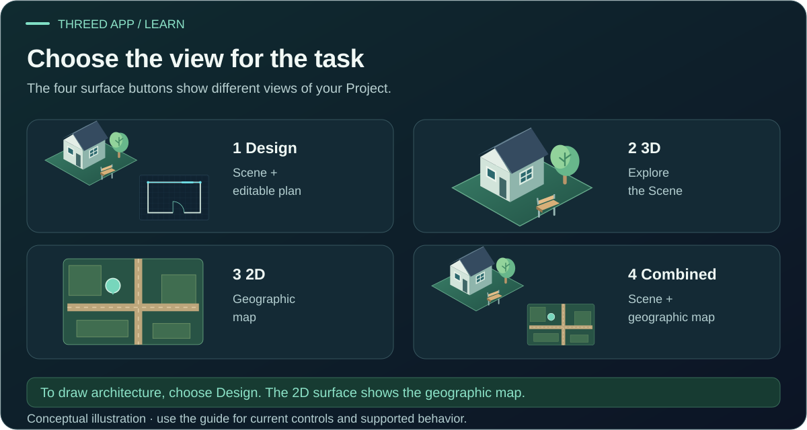
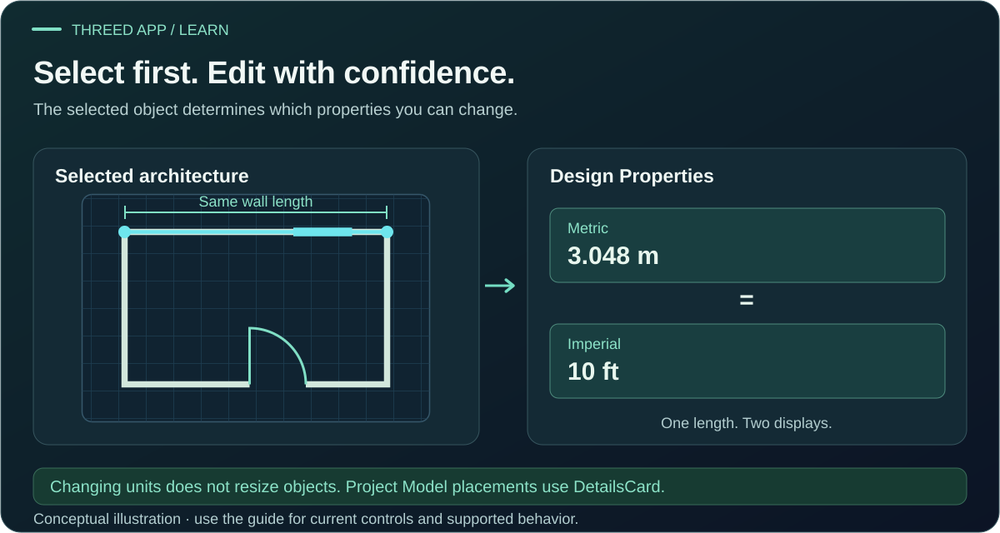
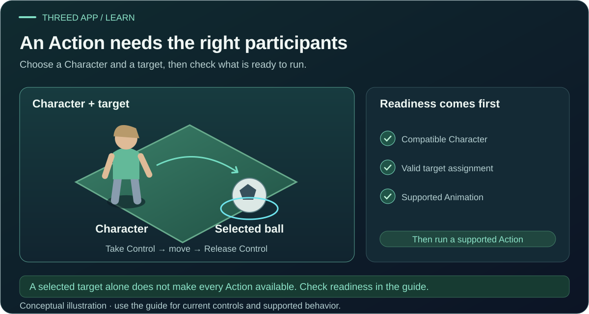

# ThreeD Controls

Open `/dashboard/scene`, choose a Project, and select a ThreeD marker to open its **DetailsCard**. Sign in and own the Project to edit and save its content. For a first session, start with [Getting Started](GETTING_STARTED.md).

## Dashboard workspace header

*Conceptual illustration: Design contains the editable plan. The 2D surface is the geographic map.*

- Select the Project name to view status, save the complete Project, change Projects, or open its Admin page.
- Use the view buttons in their displayed order: **3D, Design, 2D, Combined**. Design contains the editable architectural plan; 2D is the geographic Map.
- Use **Setup → Project Tour** for guided Project setup and Help. The Project menu also opens the Tour.
- Open **Scene > Scene Setup** for ground dimensions, Ground Map, lighting and Environment Model. The Scene menu also provides view and layer controls.
- In 3D, Design or Combined mode, select **Add** to choose Shapes, Models, Characters, FarmBots, Beds or Plantings. In the Model Library, use **All Models** or a collection, then optionally narrow results by readiness or name. Collections describe reusable Library Models; Project Assets lists instances already placed in the Project. **Inspect** previews a reusable Model; **Place** adds another instance.
- In 2D-only mode, **Add Model** retains the Map-supported Model placement workflow.
- While a marker is awaiting placement or a Model is awaiting repositioning, the header shows the active operation. Select its X button to cancel that complete Scene operation.
- Use the far-right Save icon for quick access to the same **Save ThreeD Project** transaction available in the Project menu. Project Assets and individual Libraries provide their own scoped search and filtering, while Scene Layers control module visibility.
- Use **Setup → Scenarios** for plan guidance and **Setup → Simulations** for supported Action runs. Use **Setup → Reset Overlay Positions** when you need to restore panel placement.

When a nested Physics Sensor is selected in Project Assets, its focused inspector presents the parent asset, **Place it in the Scene** controls, detection and group settings, then precise geometry fields. **Save Sensor** appears after a changed form value; **Remove sensor** is an optional action at the bottom. See [Physics Sensors and Sensor Groups](../developers/THREED_PHYSICS_SENSORS.md) for the full workflow.

The toolbar separates Project guidance from live Scene presentation: **Project Tour** owns setup/Help and **Scene** owns Scene presentation. The **DetailsCard** remains responsible for the selected marker's actions and editing. See [ThreeD Ground Maps](THREED_GROUND_MAPS.md) for image-ground setup and alignment.

## 2D Design tools and navigation

*Conceptual illustration: Select the object before editing. A unit change does not resize it.*

In Design mode, the drawing toolbar is inside the upper-right of the 2D canvas, clear of the X/Z rulers. Groups are **Select, Select Objects, Pan | Wall, Floor, Roof | Door, Window | Skylight, Roof Cutout | Fit Plan, Zoom to Selection, Reset View**. Hover or focus a button for its tooltip.

Choose **Select Objects** and click objects one by one to add them, or drag a rectangle in either direction around the walls, floors or roofs you want to move on visible levels. Release to outline fully enclosed objects in yellow. Drag the yellow **Drag to move** handle beside the selection or any highlighted member to move the selection. The **Create ThreeD Group** action sits beside **Select Objects**. To inspect one object in Design Properties, choose **Select** and click it. Openings follow their hosts. If a selected object shares a corner with an unselected one, moving separates that corner so the neighboring object stays in place. Undo restores the original connections.

With the canvas focused, press **Ctrl+A** or **Cmd+A** to select the Design across levels and all placed Models in the Project. Drag a highlighted member to move the selection on X/Z. Choose **Create ThreeD Group**, enter a name, and use **Save Project** to keep its membership. Use the **ThreeD Groups** list in Select Objects to recall it. **Ungroup** removes the group and keeps its members in place.

With Wall selected, drag between endpoints or click each endpoint. Click again to extend the wall, or press Escape to finish. Other tools support dragging a blank area to pan. Panning retains the active tool, selected entity and unfinished drawing points. Select and Pan remain separate tools. Use Pan, Alt-drag or middle-drag to pan even when starting over an object. Wheel zoom stays anchored to the pointer; use Fit Plan or Zoom to Selection to frame content. Save Project uses the existing architecture and workspace snapshot.

Choose **Design settings → Project measurement units** for Imperial or Metric. Length inputs use inches or centimetres; X/Z rulers use feet or metres. Rotation uses degrees. This is a display/input preference, not a change to object size, Scene calibration or physics.

With **Roof** active, check **One-sided roof** to draw a single slope across the footprint. Leave it unchecked for two slopes meeting at a ridge. On a finished roof, use **Properties > Roof type** to switch between Shed, Gable and Flat.

Choose **Wall Cutout** beside **Door** and **Window**, then click the wall in the plan. Draw at least three corners in the face view and choose **Finish Cutout**. The outline can meet the base, ends or sloped top. Other openings appear as guides. To reshape it later, select the cutout and choose **Edit cutout outline**. Click a corner to highlight it in pink, then choose **Remove Point** (circled minus) in the toolbar. You can also right-click the corner and choose **Remove Point**, or Shift-click it. This also works on selected Roof Cutouts, Roofs and Floors in the plan. Finished polygons need at least three corners. Drag a yellow corner or use an edge **+**, then finish and **Save Project**.

Choose **Roof Cutout** and click at least three corners inside the same roof. Choose **Finish Cutout**, press Enter, or click the first corner to close the shape. With **Select**, drag a yellow cutout corner or an edge **+** to reshape it. To open a notch at the perimeter, place two cutout corners on the roof edge. Corners snap to nearby edges. Leave one inch between openings. Skylights use the rectangular placement tool.

To reshape an existing roof, choose **Select** and click its outline. Click a **+** at an edge midpoint to add a corner, or drag the **+** directly to the desired location. Drag yellow corners to adjust the footprint. You can repeat this on any edge and undo each edit.

Floor and Roof drafts need at least three corners. Finish the draft with its Finish control, Enter or the first corner. Escape cancels unfinished drawing. Shift constrains drawing to X/Z axes. Delete/Backspace removes the selected architectural entity; Ctrl/Cmd-Z undoes, and Ctrl/Cmd-Shift-Z or Ctrl/Cmd-Y redoes. These shortcuts leave text-field editing alone. **Drawing defaults** affect new geometry; **Properties** edits the selected object.

## Characters

*Conceptual illustration: Character, target, compatible Animation and readiness must agree.*

- Autonomous `GardenCharacter` characters use their configured NPC movement behavior, which may include wandering, patrol, circle, follow, teleport, or stationary behavior.
- Movable `EcctrlCharacter` characters expose **Take Control** and **Release Control**.
- While controlling a character, use `WASD` to move. The configured controller also supports running and jumping.
- Idle, walk, run, and task animations use the configured semantic Animation Action Mapping and external FBX clips.

### When Character actions are active

The DetailsCard reports **Animations · Loaded** when the Character runtime exposes loaded actions. This does not mean that every displayed Action Slot is available. An action becomes active only when all of these conditions are satisfied:

- The Action Slot is active in **Admin → ThreeD → Animation Slots**.
- The Character has a Character-level animation assignment, or its assigned Model provides an inherited animation default. A Character assignment takes precedence over its Model default.
- The assigned animation and clip are active and their source file loads successfully.
- The animation's authored track targets exist on the Character's skeleton. The App validates this binding; it does not automatically retarget an incompatible animation.
- The loaded runtime exposes the clip under the Action Slot's action key.

Importing an animation into the Library does not assign it to a Character. Use **Admin → ThreeD → Characters → Animations & Actions** to preview a clip against the Character, then assign it to an active Action Slot. **Take Control** enables Ecctrl movement; it does not activate animation assignments. Targeted world actions can additionally require Character control, a valid target, interaction range, and no interaction already running.

If the DetailsCard says **Loaded** but lists a category as **Inactive**, check whether its Action Slots match available loaded actions. Check the Character override, its Model defaults, the slot's active state, the animation record/file, and skeleton compatibility. Legacy bundled action fallbacks are limited to Models that have been explicitly verified; the current verified Farmer Female fallback is not automatically assumed compatible with Farmer Male or other rigs.

## Targeted world actions

Select a valid Planting target and choose a supported action from the Character's DetailsCard. Water and Pick Fruit run as one-shot animations. Their persistence occurs only after animation completion; read the completion or error feedback before retrying.

Every rendered ThreeD Marker can be selected with **Use as Action Target**. This includes Plantings, Beds, Characters, FarmBots, and Models. The current target keeps a green pulse after another marker is selected. Beds, Characters, FarmBots, and Models expose Point, Point Gesture, and Talk; Plantings also expose their supported farming and harvesting actions.

Selection and action targeting are separate state. Releasing character control must not silently execute an action.

If an animation runs but persistence fails, record the toast/console error, character, project, and target before retrying.

For a movable ball target, mapped foot-kick animations can move the ball on animated foot contact. The separate **Kick selected ball** control applies an assisted kick after its animation. Both require the supported Character/target, compatible mapping and range. A kick does not itself score a goal; a qualifying Sensor entry does. See [Scenarios](../help/threed-scenarios.md#soccer) and [Simulations](../help/threed-simulations.md) for setup and recorded runs.

## FarmBot action targeting

Select an assigned FarmBot marker and choose **Use as Action Target**. The marker receives the persistent green target pulse, and the Character's DetailsCard offers **Point**, **Point Gesture**, and **Talk** under FarmBot Interaction.

These actions animate the character only. They do not call the ThreeD World Action persistence route, connect to MQTT, change a peripheral, or operate the physical FarmBot. Use **Focus Target** to return the camera to it or **Clear Target** to restore the character's full action palette.

Use a movable EcctrlCharacter and approach the FarmBot with WASD. While the FarmBot remains the action target, `W` moves toward it, `S` moves away, and `A`/`D` strafe relative to that path regardless of camera mode, orbit, perspective, or zoom. Clearing the target restores ordinary camera-relative WASD. The DetailsCard reports the current distance and enables FarmBot interaction buttons only after the Character enters interaction range. GardenCharacter remains autonomous and does not automatically approach a FarmBot target.

**Live FarmBot State** separately shows recorded connection state, observation times and device position when available. Live, stale, disconnected and unavailable describe observation conditions; they do not prove equipment readiness or authorize physical commands.

## Related Multimedia Albums

This describes the unreleased v0.30.0 checkpoint, following the [Schema-First, Top-Down Module Plan](../plans/app-module-architecture.md). Real-App verification remains pending. Learn guide associations are excluded; their retained SQL follow-up stays on hold.

1. The current saved Model, Character, FarmBot, Bed, Simulation, Scenario, Planting and Plant editors expose **Multimedia Albums > Edit Albums**. The editor supplies the selected record identity; no Sub-Module choice is needed.
2. Search for Albums and check the ones you want. Each Album appears once. Selected Albums stay visible during searches and paging. Expand **Order** only if you want to change Sort Order.
3. Select **Save Album assignments**. Wait for the saved status. These assignments save separately from the record's Details. Unchecking an Album removes only its relationship. Discard restores the loaded selection; Reload fetches saved assignments and asks before discarding changes. Conflicts retain your draft.
4. Optionally choose an active **Project / Multimedia module** immediately below the Album selection, then select **Add related Albums to Project**. Save Album changes first. This adds Project Assets without replacing existing assets; existing assignments and partial failures are reported, and retry is safe.
5. Open the Project Scene and refresh **Project Assets > Multimedia** to see eligible Albums.

Several other catalog editors use the same Album section, while some expose only a header or the general [Album manager](/admin/threed/album-associations). This is not complete saved-editor coverage. Designs displays Projects and its Multimedia entry follows Project management. Project architectural Designs retain their Project-owned editing and Save workflow. Assembly UUID associations require the separately reviewed manual identity SQL before use.

Catalog relationships remain owner-scoped. Project additions retain existing Project and Album permission checks. Project/public visibility does not publish private Albums.

Closing an Album editor with unsaved changes asks for confirmation; closing while saving is blocked. The parent editor stays open, preserving its own draft. Save new records before assigning Albums.

### Play an Album from a Scene object

1. Save the object's Album relationships and add the Album to the Project's active Multimedia assignment. Place the object and explicitly Save the Project.
2. Select the object in the Scene and expand **DetailsCard > Multimedia**. Choose an Album and Track, then **Play Multimedia**. Only readable Albums assigned to both the object and Project appear. Models, Characters, Beds, FarmBots and Plantings have this Scene section.
3. Use **Pause**, **Stop**, **Rewind** or **Next Track**. Rewind returns to zero; Next stays within the Album. Closing DetailsCard keeps the Project player; switching Projects or hiding the target's Layer stops it. If the browser blocks playback, click Play explicitly.
4. To use a Character, Take Control of the saved Character, approach the object and enable **Use controlled Character**. For collision Play, configure the object's existing Sensor/contact participation, then **Enable collision playback**. Exit and re-enter to trigger again. Arming is local to this Scene session and does not create a collider or Sensor.
5. A saved Simulation can use that exact Character/target pair, optional **Run to target**, and Multimedia Actions with a related Project Album. Run it in the Project Scene. Play completes when playback starts; consecutive Play/Pause steps execute immediately. Owner Results capture before commands; failed Result saves can be retried without replay. Public runs remain local.

Live media, collision behavior and save/reopen still need Developer acceptance. See the [current checkpoint and verification outline](../releases/v0.30.0.md#october-29--authorized-integration-implementation).
